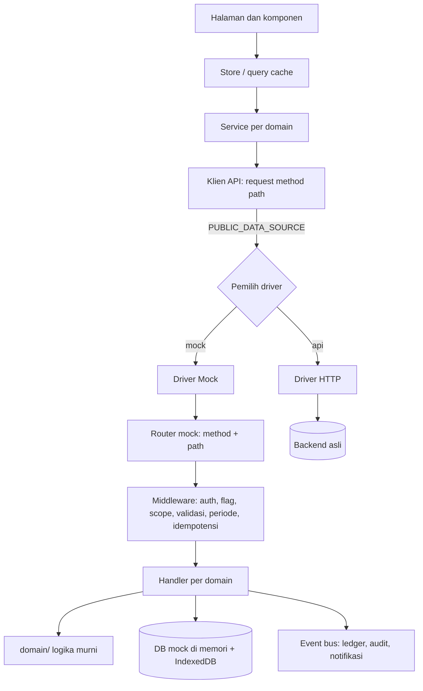

# MILESTONE: Mock UI ERP F&B yang Siap Di-switch ke Database Sesungguhnya

Pelengkap `PRD.md`. PRD menjelaskan **apa** sistemnya; dokumen ini menjelaskan **urutan membangun tampilannya** (dashboard sampai laporan, dipisah per peran) dengan data tiruan yang dapat diganti ke backend asli **tanpa mengubah komponen UI**.

---

## 0. Cara memakai dokumen ini

**Penanda status keputusan** sama dengan PRD: `[DECIDED]`, `[ASSUMED]`, `[OPEN]`. Jangan mengarang aturan `[OPEN]`; sediakan konfigurasi dan tulis `TODO(open)`.

**Konvensi ID**
- `MS-xx` milestone · `T-xx.n` tugas · `AC-xx.n` kriteria penerimaan · `EP` endpoint kontrak · `R-nn` laporan · `PG-...` halaman.
- Peran memakai kode PRD: `owner`, `hq_admin`, `finance`, `store_manager` (SM).

**Cara membaca tiap milestone:** Tujuan → Dependensi → Layar per peran → Kontrak (endpoint) → Perilaku mock wajib → Data seed → Tugas → Kriteria penerimaan → Estimasi.

**Aturan kerja agent**
1. Kerjakan berurutan; satu milestone selesai bila semua `AC` lulus di driver `mock` **dan** suite kontrak tidak gagal.
2. Dilarang mengimpor apa pun dari `drivers/mock` di luar folder `api/`. Pelanggaran = milestone belum selesai.
3. Semua angka ambang, tarif, persentase, pembulatan, dan penyetuju dibaca dari data konfigurasi, bukan konstanta di komponen.
4. Waktu hanya lewat `clock.now()`. Dilarang memanggil `Date.now()` atau `new Date()` langsung di logika bisnis.
5. Uang dan jumlah selalu string desimal di batas API (lihat 4.2).
6. Tiap layar wajib punya empat keadaan: **memuat, kosong, galat, tidak berhak**.

---

## 1. Tujuan dan definisi sukses

**Tujuan ganda**
1. **Demo yang bisa diklik end-to-end** untuk klien: dari dashboard sampai laporan, untuk empat peran, dengan data yang hidup dan konsisten.
2. **Fondasi UI produksi:** layar yang sama dipakai saat backend asli siap.

**Arti "switch" `[DECIDED]`**
Mengubah **satu konfigurasi** (`PUBLIC_DATA_SOURCE=api`) membuat seluruh layar memakai backend asli. Tidak ada komponen, halaman, atau store yang diubah. Hanya *driver data* yang berganti.

**Kriteria sukses switch**
- 100% layar berjalan di driver `mock` dan driver `api`.
- Suite uji kontrak yang sama lulus di kedua driver.
- Mode **hibrida** didukung: sebagian domain memakai `api`, sisanya `mock` (migrasi bertahap per modul backend).
- Tidak ada pemanggilan `fetch` langsung dari komponen.

---

## 2. Prinsip desain

| # | Prinsip | Akibat praktis |
|---|---|---|
| P1 | **UI buta sumber data.** | Komponen hanya memanggil fungsi service; service memanggil klien API; klien memilih driver. |
| P2 | **Kontrak dulu.** | Tipe, skema validasi, endpoint, dan kode galat ditulis sebelum layar. Mock dan backend mengikuti kontrak yang sama. |
| P3 | **Mock = simulasi perilaku, bukan JSON statis.** | Mock menegakkan state machine, validasi, izin, scope outlet, periode tertutup, persetujuan, dan efek samping (ledger, audit, notifikasi). |
| P4 | **Logika bisnis murni dipisah** di `domain/`. | Harga, resep, HPP, moving average, True-Up, evaluasi persetujuan, alokasi pembayaran, aging dipakai mock sekarang dan jadi acuan uji paritas untuk backend nanti. |
| P5 | **Izin dan scope outlet ditegakkan di driver**, bukan hanya di UI. | Mock meniru backend (403/404). UI hanya menyembunyikan. |
| P6 | **Tanpa angka ajaib.** | Ambang kas kecil, tarif pajak, markup, pembulatan, penyetuju = data konfigurasi. |
| P7 | **Waktu bisa dibekukan.** | `clock` dapat diatur untuk demo yang konsisten. |
| P8 | **Snapshot dan versi** pada resep, harga, markup, pajak. | Riwayat tidak berubah saat konfigurasi berubah. |
| P9 | **Satu sumber label status** (kamus status, warna, ikon). | Lencana konsisten di seluruh aplikasi. |
| P10 | **Data demo konsisten.** | Angka kartu, grafik, tabel, dan laporan berasal dari sumber data yang sama, bukan nilai tulisan tangan. |

---

## 3. Arsitektur lapisan mock ⇄ nyata

### 3.1 Diagram



### 3.2 Ide kunci: "server mini di dalam browser"
Driver mock **bukan** fungsi per layar, melainkan **router yang mencocokkan `method + path` persis seperti backend**. Konsekuensinya:
- Service memanggil `api.get('/inventory/stock', { query })` dan tidak tahu itu mock atau nyata.
- Driver HTTP hanya meneruskan request yang sama ke jaringan.
- Menambah endpoint = menambah handler mock **dan** (nanti) endpoint backend dengan kontrak sama.

### 3.3 Antarmuka driver (acuan)

```ts
export interface ApiRequest {
  method: 'GET' | 'POST' | 'PUT' | 'PATCH' | 'DELETE';
  path: string;                       // mis. /inventory/stock
  query?: Record<string, unknown>;
  body?: unknown;
  headers?: Record<string, string>;   // Idempotency-Key, If-Match
  signal?: AbortSignal;
}
export interface ApiResponse<T> {
  status: number;
  headers: Record<string, string>;
  body: Envelope<T> | ErrorEnvelope;
}
export interface DataDriver {
  request<T>(req: ApiRequest): Promise<ApiResponse<T>>;
}
```

### 3.4 Pemilihan driver dan mode hibrida

| Variabel | Fungsi | Contoh |
|---|---|---|
| `PUBLIC_DATA_SOURCE` | Driver bawaan | `mock` / `api` |
| `PUBLIC_API_BASE_URL` | Alamat backend | `https://erp.example.com/api/v1` |
| `PUBLIC_DATA_SOURCE_OVERRIDES` | Driver per awalan path | `{"/inventory":"api","/procurement":"api"}` |
| `PUBLIC_MOCK_LATENCY_MS` | Simulasi latensi | `150-600` |
| `PUBLIC_MOCK_SEED` | Seed acak deterministik | `hanjo-2026` |
| `PUBLIC_MOCK_FREEZE_CLOCK` | Bekukan waktu | `2026-10-13T06:28:00Z` |
| `PUBLIC_MOCK_ERROR_RATE` | Sisipkan galat acak (uji ketahanan) | `0` (default) |

Aturan: override per awalan path menang atas default. Panel **Sumber Data** (dev-only, lihat MS-13) mengubah nilai ini saat runtime dan menyimpannya di penyimpanan lokal.

### 3.5 Struktur folder (acuan, sesuaikan dengan konvensi proyek)

```
src/lib/
  api/
    contract/            # tipe, skema validasi, kode galat, daftar endpoint
    client.ts            # request(), memilih driver, retry, mapping galat
    drivers/
      http/              # fetch tipis + token + If-Match + Idempotency-Key
      mock/
        engine/          # db, query, transaksi, clock, latensi, persistensi, seed
        middleware/      # auth, flag, scope, validasi, periode, idempotensi, audit
        handlers/        # per domain: org, catalog, inventory, procurement, ...
        seed/            # generator data deterministik
  domain/                # logika murni: pricing, recipe, costing, approval, payables, pettycash, tax, projections
  services/              # satu berkas per domain, memanggil klien API
  features/<modul>/      # halaman, komponen, store per modul
  ui/                    # kit komponen: tabel, form, lencana, drawer, modal, grafik
  auth/                  # sesi, can(), pemeriksa izin dan scope
  config/                # feature flag, pengaturan, kamus status
  utils/                 # format Rupiah, tanggal WIB, satuan, desimal
tests/
  contract/              # suite yang sama untuk driver mock dan api
  domain/                # uji logika murni dengan vektor
  e2e/                   # skrip demo per peran
```

### 3.6 Aturan batas modul
- `features/*` dan `ui/*` tidak boleh mengimpor `api/drivers/*`.
- `domain/*` tidak boleh mengimpor apa pun dari `api/`, `features/`, atau `ui/` (murni).
- Mock handler boleh memakai `domain/*`; service dan UI juga boleh memakai fungsi `domain/*` yang murni untuk pratinjau (mis. kalkulator harga) tetapi **angka resmi tetap dari server/mock**.
- Aturan ini dicek dengan aturan lint pembatas impor; pelanggaran menggagalkan build.

---

## 4. Kontrak API umum (berlaku untuk semua endpoint)

### 4.1 Prefiks dan format
- Basis: `/api/v1`. JSON UTF-8. Nama field `snake_case` (selaras PRD 7.1). `[ASSUMED]`
- Waktu: ISO 8601 UTC (`2026-10-13T06:28:00Z`). Hari bisnis: string `YYYY-MM-DD` (`business_date`, dihitung `Asia/Jakarta`).
- ID: UUIDv7 string.

### 4.2 Angka
- **Uang dan jumlah dikirim sebagai string desimal** (`"20000.0000"`) untuk menghindari galat float. `[ASSUMED]`
- Presisi: jumlah dan biaya satuan 4 desimal; total uang 2 desimal. UI memakai pustaka desimal untuk penjumlahan di sisi klien.
- Persentase juga string desimal (`"5.00"` = 5%).

### 4.3 Amplop respons
```json
// sukses (objek)
{ "data": { ... } }
// sukses (daftar)
{ "data": [ ... ], "meta": { "page": 1, "per_page": 25, "total": 312, "total_pages": 13 } }
// galat
{ "error": { "code": "validation_error", "message": "string",
  "details": [ { "field": "lines[0].qty", "code": "min", "message": "string" } ],
  "request_id": "uuid" } }
```

### 4.4 Daftar, filter, urut, cari
- `GET /resource?page=1&per_page=25&sort=-created_at,name&q=kata`
- Filter: `filter[outlet_id]=...&filter[status]=submitted,approved&filter[date_from]=2026-10-01&filter[date_to]=2026-10-31`
- Daftar besar mendukung `include=lines,supplier` untuk relasi (mock dan backend sama-sama mendukung).
- Pencarian `q` mencari kolom yang didefinisikan per resource di kontrak.

### 4.5 Aksi (transisi status)
Transisi status memakai **endpoint aksi**, bukan PATCH status mentah:
`POST /purchase-orders/{id}/actions/submit` · `.../approve` · `.../cancel`, dan seterusnya.
Respons: dokumen terbaru + `meta.effects` (daftar efek samping, mis. `stock_movements_created: 6`).

### 4.6 Konkurensi dan idempotensi
- Setiap dokumen punya `version` (integer). Pembaruan mengirim `If-Match: <version>`; ketidakcocokan → `409 conflict` dengan `details[0].code = version_mismatch`.
- `POST` pembuatan dokumen dan data masuk dari sistem luar menerima `Idempotency-Key`. Pengulangan dengan kunci sama mengembalikan respons semula, tidak membuat data ganda.

### 4.7 Kode galat baku

| HTTP | `code` | Dipakai untuk |
|---|---|---|
| 401 | `unauthenticated` | Sesi tidak ada/kedaluwarsa. |
| 403 | `forbidden` | Peran tidak punya izin. |
| 403 | `feature_disabled` | Fitur dimatikan. |
| 404 | `not_found` | Tidak ada, atau di luar scope outlet pengguna. |
| 409 | `conflict` | Versi tidak cocok, status tidak valid untuk aksi, referensi masih dipakai. |
| 409 | `period_closed` | Posting ke periode tertutup. |
| 422 | `validation_error` | Isian tidak valid (dengan `details`). |
| 422 | `approval_required` | Aksi butuh persetujuan lebih dulu (dengan `details` berisi aturan dan penyetuju). |
| 422 | `limit_exceeded` | Melewati batas dan mode ketat memblokir. |
| 429 | `rate_limited` | Pembatasan laju (simulasi/nyata). |
| 500 | `server_error` | Galat tak terduga. |

### 4.8 Sesi dan izin
- `GET /me` → `{ user, roles[], outlet_ids[], permissions[], feature_flags{}, settings{} }`. UI memakai ini untuk `can(aksi, sumber, outlet_id?)`.
- `GET /nav/badges` → hitungan lencana menu (persetujuan menunggu, stok di bawah minimum, nota menunggu, dan seterusnya) sesuai peran dan scope.
- Peran dev-only: `POST /dev/switch-role` hanya ada di driver mock.

### 4.9 Lampiran
- `POST /attachments` (multipart) → `{ id, url, mime, size }`. Mock menyimpan berkas sebagai Blob di IndexedDB dan memberi URL objek; backend memberi URL bertanda tangan.
- Batas: 5 MB per berkas; tipe `image/jpeg|png|webp|application/pdf`.

### 4.10 Ekspor
`GET /reports/{key}?format=csv|xlsx|pdf&...filter`. Mock membuat CSV/XLSX di sisi klien dari hasil query yang sama; PDF memakai tata letak cetak. Backend nanti dapat mengembalikan berkas atau tautan unduh.

---

## 5. Mesin mock (komponen wajib)

| Komponen | Spesifikasi |
|---|---|
| **DB mock** | Koleksi di memori dengan indeks (id, kunci asing, `outlet_id`, `business_date`), relasi (`include`), transaksi atomik `db.tx(fn)` (gagal → semua perubahan dibatalkan). |
| **Persistensi** | Disimpan ke IndexedDB dengan versi skema. Tombol **Reset demo** (seed ulang), **Ekspor/Impor keadaan** (JSON), dan **Skenario** (lihat MS-13). |
| **Seed deterministik** | Generator dengan seed tetap (`PUBLIC_MOCK_SEED`), tanggal relatif terhadap `clock.now()`. Hasil sama setiap kali. |
| **Clock** | `clock.now()`, `clock.freeze(iso)`, `clock.advance(ms)`. Semua logika waktu lewat sini. |
| **Latensi dan galat** | Latensi acak dalam rentang konfigurasi; opsi menyisipkan galat 500/429 untuk menguji keadaan galat. |
| **Router** | Mencocokkan `method + path` (dengan parameter). Satu tabel rute berisi: izin, aturan scope, skema validasi, handler. |
| **Middleware (urutan tetap)** | `auth` → `feature_flag` → `permission` → `scope_outlet` → `validate` → `idempotency` → `period_guard` (untuk posting) → handler → `audit` → `notify`. |
| **Event bus** | Handler memancarkan event domain (`GoodsReceived`, `InvoiceVerified`, `CostTrueUpPosted`, `StockMoved`, `ApprovalRequested`, `ApprovalDecided`, `PaymentVerified`, `PeriodClosed`, `SaleIngested`). Subscriber memperbarui ledger, saldo, proyeksi, notifikasi. |
| **Proyeksi** | Saldo stok, rata-rata biaya, hutang, kas kecil, kartu dashboard, dan laporan dihitung dari koleksi sumber (ledger, dokumen), **bukan disimpan sebagai angka tulisan tangan**. |
| **Audit writer** | Setiap permintaan mutasi menulis `audit_logs` (aktor, aksi, entitas, diff sebelum/sesudah, IP palsu, perangkat). |
| **Notifikasi** | Event tertentu menulis `notifications` untuk penerima yang relevan (penyetuju, pembuat, store manager). |
| **Penyimpanan berkas** | Blob di IndexedDB. |
| **Kunci idempotensi** | Disimpan dalam peta dengan kedaluwarsa; pengulangan mengembalikan respons semula. |

**Perilaku yang wajib ditiru dari backend**
1. Membaca atau menulis data di luar scope outlet → `404` (atau `403` untuk aksi), dan kejadian masuk audit log.
2. Dokumen yang sudah diposting tidak dapat diubah (`409 conflict`).
3. Posting bertanggal di periode tertutup → `409 period_closed`.
4. Fitur dimatikan → `403 feature_disabled` untuk semua endpoint domain itu.
5. Aksi yang butuh persetujuan tanpa persetujuan → `422 approval_required`.
6. Pembuat tidak dapat menyetujui dokumennya sendiri.
7. Versi tidak cocok → `409 conflict`.

---

## 6. Logika domain bersama (`domain/`) dengan vektor uji

Fungsi murni, bebas I/O. Tiap fungsi punya uji unit dengan vektor berikut sebagai **acuan paritas** untuk backend nanti.

### 6.1 Harga akhir channel
`harga_akhir = pembulatan((harga_dasar + Σ price_delta) × (1 + markup_pct/100))`
Mode pembulatan: `nearest | up | down`, langkah `100 | 500 | 1000` (konfigurasi).

| Masukan | Hasil |
|---|---|
| dasar 28.000, modifier +3.000, markup 5%, nearest 500 | (31.000 × 1,05 = 32.550) → **32.500** |
| dasar 28.000, tanpa modifier, markup 0% | **28.000** |
| dasar 25.000, markup 5%, up 1.000 | (26.250) → **27.000** |

### 6.2 Resolusi resep
Untuk (varian, outlet O, waktu T): pilih resep override outlet O yang aktif pada T; jika tidak ada, pilih resep standar yang aktif pada T. Tidak boleh ada dua resep aktif untuk kombinasi yang sama (validasi saat menyimpan).

### 6.3 Efek modifier pada resep
Urutan penerapan: `replace` → `add` → `multiply`. Contoh: resep susu sapi 150 ml; opsi susu oat (`replace`: susu sapi → susu oat, rasio 1,0); extra shot (`add`: biji kopi +18 g); less ice (`multiply`: es × 0,5). Hasil: susu oat 150 ml, biji kopi +18 g, es 50% dari semula.

### 6.4 HPP varian per outlet
`HPP = Σ [ qty_bahan × (1 + waste_pct/100) × avg_cost_outlet(bahan) ]` setelah efek modifier.

**Vektor (Aren Latte Iced, satuan pakai):**

| Bahan | Qty | avg_cost | Biaya |
|---|---|---|---|
| Biji kopi | 18 g | 280/g | 5.040 |
| Susu | 150 ml | 18/ml | 2.700 |
| Gula aren | 20 ml | 25/ml | 500 |
| Es | 100 g | 3/g | 300 |
| Cup+tutup | 1 pcs | 600 | 600 |
| **HPP** | | | **9.140** |

Harga 28.000 → margin = (28.000 − 9.140) / 28.000 = **67,4%**. Dengan extra shot: HPP **14.180**, harga +3.000.

### 6.5 Rata-rata bergerak (moving average)
`avg_baru = (qty_lama × avg_lama + qty_masuk × biaya_masuk) / (qty_lama + qty_masuk)`.
Vektor: 10 L @ 18.000 + terima 20 L @ 21.000 → **20.000**. Pengeluaran stok tidak mengubah `avg`. Jika `qty_lama ≤ 0`, `avg_baru = biaya_masuk`.

### 6.6 Biaya sementara dan True-Up
1. Penerimaan memakai `unit_cost` = harga terakhir (`provisional`).
2. Verifikasi nota: `selisih_per_unit = harga_nota − biaya_sementara`.
3. `qty_terpakai` = bagian penerimaan yang sudah keluar (FIFO nominal). `qty_sisa = qty_diterima − qty_terpakai`.
4. `penyesuaian_persediaan = qty_sisa × selisih_per_unit` → hitung ulang `avg_cost = (nilai_stok_sekarang + penyesuaian_persediaan) / qty_stok_sekarang`.
5. `penyesuaian_HPP = qty_terpakai × selisih_per_unit` → entri `cogs_adjustment` di periode terbuka.
6. Tandai pergerakan `final`.

**Vektor:** terima 6 L @ 20.000 (sementara), terpakai 2 L, nota 22.000 → selisih 2.000/L; persediaan **+8.000** (4 L), HPP **+4.000** (2 L), total 12.000.

### 6.7 Evaluasi aturan persetujuan
Untuk dokumen D (tipe, outlet, nilai): kumpulkan aturan aktif yang cocok cakupan dan ambang, **pilih tingkat tertinggi**; tidak ada yang cocok → tidak perlu persetujuan. Penyetuju = `approver_roles` dengan `mode` (`any_of` satu cukup, `all_of` semua). Pembuat dikecualikan.

### 6.8 Kas kecil bertingkat (nilai seed contoh, **bukan keputusan**)
Konfigurasi seed: batas bebas per transaksi **Rp100.000**, batas harian per outlet **Rp300.000**, batas besar **Rp1.000.000**.

| Skenario (satu outlet, satu hari bisnis) | Hasil |
|---|---|
| 80.000 | Tingkat 1: langsung tercatat |
| 80.000 lalu 150.000 | Yang kedua melewati batas per transaksi → Tingkat 2 (Finance atau pimpinan) |
| 90.000 ×3 lalu 50.000 | Total 320.000 > 300.000 → yang keempat Tingkat 2 meski di bawah 100.000 |
| 1.200.000 | Tingkat 3: pimpinan |
| 23:30 WIB lalu 00:10 WIB | Dihitung di hari bisnis berbeda |

### 6.9 Alokasi pembayaran (FIFO) dan umur hutang
Tagihan: B1 100.000 (jatuh tempo 1 Okt), B2 200.000 (10 Okt), B3 150.000 (20 Okt). Pembayaran 250.000 → B1 lunas (100.000), B2 dibayar 150.000 (sisa 50.000), B3 0. Total alokasi ≤ jumlah pembayaran; sisa jadi `on_account`.
Bucket umur: **belum jatuh tempo**, **1-30**, **31-60**, **61-90**, **>90** hari lewat jatuh tempo.

### 6.10 Proyeksi stok
`saldo = Σ qty` pergerakan. `estimasi_sisa_hari = saldo / rata-rata_pemakaian_harian_14_hari`; bila pemakaian 0 tampil "—". Peringatan bila `saldo < min_stock`; "kritis" bila `saldo ≤ 50% min_stock` `[ASSUMED]`.

### 6.11 Rumus kartu dashboard
- **Omzet bersih** = Σ penjualan tanpa pajak. **Laba kotor** = omzet bersih − HPP (aktual atau sementara). **Margin** = laba kotor ÷ omzet bersih.
- Lencana **Estimasi** muncul bila ada nota tertunda untuk penerimaan pada rentang itu; teksnya memuat jumlah nota tertunda.

---

## 7. Peran dan akun demo

| Akun demo | Peran | Cakupan | Fokus demo |
|---|---|---|---|
| Rina | `owner` | Semua outlet | Perbandingan outlet, persetujuan tingkat atas, laba. |
| Dimas | `hq_admin` | Semua outlet | Master, menu, resep, harga, usulan menu, status outlet. |
| Maya | `finance` | Semua outlet | Verifikasi nota, pembayaran, hutang, kas kecil, pajak, periode. |
| Budi | `store_manager` | Outlet A | Operasional harian satu outlet. |
| Sari | `store_manager` | Outlet B dan C | Penugasan multi-outlet dan pemilihan outlet. |

Pengalih peran (dev-only) ada di menu pengguna; pada produksi hilang.

**Prinsip tampilan per peran:** menu, kartu, dan tombol hanya muncul bila `can(...)` benar **dan** feature flag aktif. Tampilan tidak boleh bergantung pada pengecekan peran yang tersebar di komponen; gunakan `can()` terpusat.

---

# BAGIAN B: MILESTONE

Ringkasan urutan dan usaha kasar (hari kerja satu orang, `[ASSUMED]`):

| MS | Isi | Usaha |
|---|---|---|
| 00 | Fondasi dan kontrak | 7-9 |
| 01 | Shell, navigasi, dashboard (4 peran), status EOD | 8-10 |
| 02 | Outlet dan mitra | 4-5 |
| 03 | Katalog: bahan, satuan, pemasok | 5-6 |
| 04 | Katalog: menu, modifier, resep, harga, channel | 10-12 |
| 05 | Mesin persetujuan dan inbox | 6-7 |
| 06 | Inventaris | 9-11 |
| 07 | Pembelian: permintaan, penerimaan, nota, auto-suggest PO | 11-13 |
| 08 | Hutang dan pembayaran | 8-10 |
| 09 | Biaya, kas kecil, dan tutup hari (EOD) | 8-10 |
| 10 | Usulan menu lokal | 5-6 |
| 11 | Keuangan dan pajak | 7-8 |
| 12 | Laporan (26 katalog) | 11-13 |
| 13 | Pengaturan dan audit | 6-7 |
| 14 | Latihan switch dan pengerasan | 8-10 |
| | **Total kasar** | **~117-145** |

> Estimasi kasar untuk kerja manual. Gunakan sebagai bobot relatif, bukan janji jadwal.

**Jalur demo minimum** (bila waktu terbatas, ceritanya tetap utuh): MS-00 → MS-01 → MS-03 → MS-04 (resep dan HPP) → MS-06 (stok) → MS-07 (pembelian dan nota) → MS-08 (hutang) → MS-12 (laporan laba dan stok). Sisanya menyusul.

---

## MS-00: Fondasi dan kontrak

**Tujuan:** semua yang dibutuhkan agar milestone berikutnya cepat dan konsisten: kit UI, klien API, mesin mock, sesi dan izin, feature flag.
**Dependensi:** tidak ada. **Usaha:** 7-9 hari.

### Layar per peran
Belum ada layar bisnis. Yang ada: halaman **Masuk** (pilih akun demo), halaman **403**, **404**, dan panel **Sumber Data** (dev-only).

| Peran | Yang terlihat |
|---|---|
| Semua | Masuk, 403/404, menu pengguna dengan pengalih peran (dev-only). |

### Tugas
- **T-00.1** Tooling: lint pembatas impor (aturan 3.6), format, pengecekan tipe, CI (lint, uji, build).
- **T-00.2** Token desain tema **light saja**: warna primer, netral, status (merah/kuning/biru/hijau/abu), tipografi, spasi, radius, bayangan. Kontras teks ≥ 4,5:1.
- **T-00.3** Kit komponen: Button, Input, NumberInput (desimal), CurrencyInput (Rp), Select, MultiSelect, Combobox asinkron (cari bahan/pemasok/outlet), DatePicker (WIB), DateRange, Checkbox/Radio/Switch, Textarea, FileUpload (pratinjau foto, batas ukuran/tipe), Table (paginasi server, urut, filter, kolom dapat disembunyikan, header lengket, pilih baris, ekspor), Tabs, Drawer, Modal, ConfirmDialog, **StepUpDialog** (konfirmasi kata sandi), Toast, StatusBadge (dari kamus status), StatCard, Chart (garis, batang, bertumpuk, sparkline), Timeline, DiffViewer, EmptyState, ErrorState, Skeleton, Breadcrumb, PageHeader, FilterBar (sinkron URL), CommandPalette.
- **T-00.4** Utilitas: `formatRupiah`, `formatNumber` (`id-ID`), `formatDate` (WIB), `relativeTime`, pembungkus pustaka desimal, konversi satuan, helper `business_date`.
- **T-00.5** Kontrak awal: tipe amplop, galat, paginasi, kode galat (4.7), entitas dasar (User, Outlet minimal), kamus status kosong, daftar endpoint.
- **T-00.6** Klien API: `request()`, pemilih driver, override hibrida, retry hanya untuk GET, pembatalan, pemetaan galat bertipe, `request_id`, helper `Idempotency-Key` dan `If-Match`.
- **T-00.7** Mesin mock inti (bagian 5): DB, `tx`, router, rantai middleware, clock, latensi, persistensi, kerangka seed, event bus, audit writer, notifikasi, kunci idempotensi, penyimpanan berkas.
- **T-00.8** Auth mock: layar Masuk, sesi, `GET /me`, `can()`, penjaga rute, pengalih peran, keluar, simulasi sesi kedaluwarsa.
- **T-00.9** Penyedia feature flag dari `/me`, util validasi dependensi flag, komponen `<Feature flag="...">`.
- **T-00.10** Kerangka shell: tata letak, sidebar dari konfigurasi navigasi, header, area konten, error boundary, halaman 403/404.
- **T-00.11** i18n bahasa Indonesia, kamus label status, katalog pesan validasi dalam bahasa Indonesia.
- **T-00.12** Kerangka uji: harness uji kontrak yang menerima driver sebagai parameter, uji domain, e2e, generator fixture.
- **T-00.13** Panel Sumber Data minimal: ganti driver, reset, bekukan clock, atur latensi dan laju galat.
- **T-00.14** Dokumentasi "cara menambah endpoint": kontrak → handler mock → service → UI → uji kontrak.

### Kriteria penerimaan
- **AC-00.1** Mengganti `PUBLIC_DATA_SOURCE` memilih driver yang benar (diuji dengan server palsu untuk `api`).
- **AC-00.2** Berkas contoh yang sengaja mengimpor `drivers/mock` dari `features/` menggagalkan lint dan build.
- **AC-00.3** `GET /me` sesuai akun yang masuk; `can()` mengembalikan hasil benar untuk empat peran.
- **AC-00.4** Request tanpa sesi → `401` → UI kembali ke Masuk.
- **AC-00.5** `Idempotency-Key` yang sama tidak membuat data ganda pada endpoint contoh.
- **AC-00.6** `db.tx` membatalkan semua perubahan saat ada galat di tengah.
- **AC-00.7** `clock.freeze` mengubah nilai `now` di seluruh aplikasi.
- **AC-00.8** Setiap komponen kit punya contoh tampilan dan lulus pemeriksaan kontras.
- **AC-00.9** Reset demo menghasilkan data identik (hash seed sama untuk seed sama).

---

## MS-01: Shell, navigasi, dan dashboard

**Tujuan:** kerangka aplikasi lengkap dan dashboard responsif untuk empat peran, dari data proyeksi mock. Termasuk status End of Day (EOD) per outlet.
**Dependensi:** MS-00. **Usaha:** 8-10 hari.

### Navigasi (sidebar berkelompok) `[ASSUMED]`, diselaraskan dengan PRD 8.4

| Grup | Menu | Rute | Peran | Flag | Lencana |
|---|---|---|---|---|---|
| (atas) | Dashboard | `/dashboard` | semua | – | – |
| (atas) | Persetujuan | `/approvals` | semua | – | `approvals.pending_for_me` |
| Operasional | Inventaris | `/inventory` | semua (SM terbatas outlet) | `inventory` | `inventory.below_min` |
| Operasional | Pembelian & Hutang | `/procurement`, `/payables` | semua (isi per peran) | `procurement` | `procurement.invoices_waiting` |
| Operasional | Biaya & Kas Kecil | `/petty-cash`, `/costs` | semua (Biaya Pusat tidak untuk SM) | `petty_cash` | `petty_cash.pending_verification` |
| Keuangan | Keuangan & Pajak | `/finance` | `owner`, `hq_admin` (baca), `finance` | `tax` untuk submenu Pajak | `finance.true_up_pending` |
| Keuangan | Laporan | `/reports` | semua (isi per peran) | – | – |
| Master Data | Katalog & Resep | `/catalog` | semua (SM baca + Usulan Menu) | – | `catalog.proposals_pending` |
| Master Data | Outlet & Mitra | `/org` | `owner`, `hq_admin`, `finance` (baca), SM (baca outlet sendiri) | `partner_ownership` untuk submenu Pemilik | – |
| Sistem | Pengaturan | `/settings` | `owner`, `hq_admin`, `finance` (baca terbatas) | – | – |

Aturan: grup berbentuk akordeon (hanya grup aktif terbuka); sidebar dapat dilipat menjadi ikon dengan tooltip dan keadaannya diingat per pengguna; label seksi huruf kapital kecil; **Penjualan hanya-baca masuk ke Laporan** (R-17, R-18), bukan menu sendiri.

**Aturan lencana:** hanya untuk hal yang menunggu tindakan dan berupa angka; warna menunjukkan urgensi (merah = lewat batas, kuning = peringatan, biru = informasi).

### Header
- **Pemilih outlet:** `owner`/`hq_admin`/`finance` → "Semua Outlet" + daftar; SM → hanya outlet yang ditugaskan (satu outlet = terkunci). **"Pusat" bukan pilihan.**
- **Filter pemilik** (milik sendiri / mitra): tersembunyi bila flag `partner_ownership` mati.
- **Rentang tanggal:** Hari ini, 7 hari, Bulan ini, Kustom. Disimpan di URL dan diingat per pengguna.
- **Pencarian global `Ctrl+K`:** halaman menu + entitas (nomor PO/nota/tagihan, bahan, menu, outlet, pemasok), hasil mengikuti scope pengguna.
- **Lonceng notifikasi:** daftar, jumlah belum dibaca, tandai dibaca, tautan ke dokumen.
- **Menu pengguna:** profil, pengalih peran (dev-only), keluar.

### Kartu dashboard per peran

Setiap kartu memuat sendiri (skeleton → data), punya keadaan galat dengan tombol coba lagi, cap "diperbarui pukul", dan tautan telusur dengan filter yang terbawa.

| Kunci kartu | Isi | Owner | Admin | Finance | SM |
|---|---|:-:|:-:|:-:|:-:|
| `action_center` | Daftar tindakan menunggu sesuai peran (di bawah) | ✔ | ✔ | ✔ | ✔ |
| `sales_summary` | Omzet, jumlah cup, rata-rata nilai transaksi, komposisi tunai/QRIS, jam ramai, void/refund, dibanding periode sebelumnya | ✔ | ✔ | – | – |
| `gross_profit` | Laba kotor dan margin (6.11), lencana **Estimasi · N nota belum masuk** | ✔ | – | ✔ | – |
| `outlet_comparison` | Peringkat outlet: omzet, margin, biaya operasional, selisih stok %, waste % | ✔ | ✔ (operasional) | – | – |
| `stock_issues` | Outlet dan bahan di bawah minimum, estimasi sisa hari, selisih opname, waste | ringkas | ✔ | – | – |
| `hq_payables` | Saldo hutang outlet ke pusat, jatuh tempo, umur hutang (termasuk mitra) | ringkas | – | ✔ | – |
| `petty_cash` | Saldo kas kecil per outlet, pengeluaran menunggu verifikasi | – | – | ✔ | – |
| `outlet_ops_status` | Sudah tutup hari atau belum, kesehatan sinkronisasi POS | ✔ | ✔ | – | – |
| `outlet_eod_status` | Daftar outlet yang sudah/belum menyelesaikan EOD (kas laci, penjualan, waste) | ✔ | ✔ | – | – |
| `payment_reconciliation` | Non-tunai ERP vs settlement Midtrans, selisih | – | – | ✔ | – |
| `true_up_pending` | Jumlah dan umur nota menunggu, nilai penyesuaian tertunda | – | – | ✔ | – |
| `sm_stock_min` | Bahan di bawah minimum di outlet sendiri, estimasi sisa hari, tombol Buat permintaan barang | – | – | – | ✔ |
| `sm_count_schedule` | Jadwal opname berikutnya dan yang terlambat | – | – | – | ✔ |
| `sm_petty_cash` | Saldo kas kecil, pengeluaran hari ini terhadap batas harian | – | – | – | ✔ |
| `sm_proposals` | Status usulan menu milik sendiri | – | – | – | ✔ |
| `sm_eod_status` | Checklist tutup hari outlet sendiri (kas laci, penjualan, waste) | – | – | – | ✔ |

**Isi `action_center` per peran**

| Peran | Item |
|---|---|
| `owner` | Persetujuan tingkat atas (belanja luar, kas kecil tingkat 3, buka ulang periode), periode siap ditutup. |
| `hq_admin` | Usulan menu menunggu, koreksi opname menunggu, outlet belum sinkron. |
| `finance` | Nota menunggu verifikasi, pembayaran menunggu verifikasi, top-up kas kecil menunggu, pengeluaran kas kecil menunggu verifikasi, tagihan jatuh tempo, periode siap ditutup. |
| `store_manager` | Permintaan barang berstatus draft, penerimaan belum tuntas, nota yang harus diinput, nota ditolak, usulan menu perlu revisi, opname terjadwal, **tutup hari belum selesai**. |

### Kontrak (endpoint)
- `GET /nav/badges`
- `GET /notifications` · `POST /notifications/{id}/read` · `POST /notifications/read-all`
- `GET /search?q=&types=`
- `GET /dashboard/cards/{key}?outlet_id=&owner_type=&from=&to=`
- `GET /eod/status?outlet_id=&date=` · `POST /eod/complete` · `GET /eod/summary?outlet_id=&date=`

### Perilaku mock wajib
1. Kartu dihitung dari proyeksi koleksi sumber (ledger, dokumen, penjualan), bukan angka tulisan tangan.
2. Scope: SM tidak pernah mendapat data outlet lain, termasuk di `outlet_comparison` (kartu itu tidak tersedia untuk SM).
3. Lencana menu dan jumlah item `action_center` berasal dari satu sumber hitung yang sama dengan inbox/daftar tujuan.
4. `gross_profit` menandai Estimasi bila ada nota tertunda untuk penerimaan dalam rentang.
5. Halaman tujuan yang belum dibangun menampilkan halaman **"Segera hadir"** yang memuat nama milestone terkait.

### Data seed yang dibutuhkan
Penjualan harian 90 hari per outlet (variasi akhir pekan, tren naik moderat), dokumen dalam berbagai status (lihat Lampiran B), stok beberapa bahan di bawah minimum, satu outlet belum sinkron lebih dari 2 jam, tiga nota menunggu verifikasi, selisih Midtrans kecil.

### Tugas
- **T-01.1** Konfigurasi navigasi deklaratif (peran, flag, lencana) dan render sidebar (akordeon, lipat, ingat keadaan).
- **T-01.2** Header: pemilih outlet (dengan aturan peran), filter pemilik, rentang tanggal (URL + ingat), pencarian global, lonceng, menu pengguna.
- **T-01.3** Layanan lencana dan notifikasi (mock + UI).
- **T-01.4** Pencarian global (mock indeks entitas) dan `CommandPalette`.
- **T-01.5** Kerangka dashboard: grid responsif (minimum tablet portrait ≥ 768px), kartu mandiri dengan skeleton, galat, cap waktu. Sidebar auto-collapse pada viewport ≤ 1024px.
- **T-01.6** Proyeksi kartu untuk Owner: `action_center`, `sales_summary`, `gross_profit`, `outlet_comparison`, `stock_issues` (ringkas), `hq_payables` (ringkas), `outlet_ops_status`.
- **T-01.7** Proyeksi kartu untuk Admin: `action_center`, `stock_issues`, `outlet_ops_status`, `outlet_comparison` (operasional), `sales_summary`.
- **T-01.8** Proyeksi kartu untuk Finance: `action_center`, `hq_payables`, `petty_cash`, `payment_reconciliation`, `gross_profit`, `true_up_pending`.
- **T-01.9** Proyeksi kartu untuk SM: `action_center`, `sm_stock_min`, `sm_count_schedule`, `sm_petty_cash`, `sm_proposals`, `sm_eod_status`.
- **T-01.14** Kartu status End of Day (EOD) per outlet: `outlet_eod_status` (Owner/Admin) dan `sm_eod_status` (SM, checklist tutup hari).
- **T-01.10** Grafik: tren omzet (garis) dengan sorotan hari, jam ramai (batang), komposisi pembayaran (donat/bertumpuk).
- **T-01.11** Halaman "Segera hadir" dan tautan telusur dengan filter terbawa.
- **T-01.12** Pemeriksa konsistensi demo (skrip CI) dengan cek: jam header sama dengan transaksi terbaru; tanggal pada nomor transaksi sama dengan hari bisnisnya; nilai sorotan grafik = nilai kartu pada hari yang sama; rentang grafik mencakup hari ini; Σ omzet outlet = total; tidak ada transaksi bertanggal masa depan.
- **T-01.13** Pembersihan dari prototipe: tanpa banner foto, tanpa kartu promosi, tanpa lencana LIVE/CORE/FASE 2; tulisan "Omzet" (bukan "Omset").

### Kriteria penerimaan
- **AC-01.1** Tiap peran hanya melihat kartu pada matriks di atas.
- **AC-01.2** Budi (Outlet A) tidak dapat memilih outlet lain; Sari memilih antara Outlet B dan C; Rina "Semua Outlet" + filter pemilik.
- **AC-01.3** Angka kartu sama dengan angka pada halaman telusurnya (uji otomatis per kartu setelah milestone terkait selesai).
- **AC-01.4** Lencana menu sama dengan jumlah pada halaman tujuan.
- **AC-01.5** `gross_profit` menampilkan Estimasi dengan N yang benar; N berkurang saat nota diverifikasi (setelah MS-07).
- **AC-01.6** Galat buatan pada satu kartu tidak merusak kartu lain; tombol coba lagi bekerja.
- **AC-01.7** Pencarian `Ctrl+K` menemukan halaman dan entitas; hasil mengikuti scope outlet.
- **AC-01.8** Mengubah outlet, pemilik, dan rentang memperbarui semua kartu dan tersimpan di URL.
- **AC-01.9** Pemeriksa konsistensi demo lulus di CI.
- **AC-01.10** Mematikan flag `petty_cash` menyembunyikan menu dan kartu terkait.
- **AC-01.11** Dashboard dan navigasi tampil baik pada viewport tablet (≥ 768px): kartu menyesuaikan grid, sidebar collapse otomatis, tidak ada horizontal scroll.
- **AC-01.12** Kartu `outlet_eod_status` menampilkan outlet yang belum tutup hari; `sm_eod_status` menampilkan checklist EOD per outlet SM.
- **AC-01.13** Setelah SM menyelesaikan EOD, status outlet berubah menjadi "Sudah tutup" di kartu Owner/Admin.

---

## MS-02: Outlet dan mitra

**Tujuan:** master organisasi: outlet, pemilik/investor, penugasan, grup.
**Dependensi:** MS-00, MS-01. **Usaha:** 4-5 hari.

### Layar per peran

| Halaman | Owner | Admin pusat | Finance | SM |
|---|---|---|---|---|
| `PG-org-outlets` daftar outlet | CRUA | CRU | R | R (outlet sendiri) |
| `PG-org-outlet-detail` tab Ringkasan, Pemilik, Pengguna, Syarat bayar*, Kas kecil*, Ketersediaan menu* | CRUA | CRU | R | R |
| `PG-org-owners` pemilik/investor (flag `partner_ownership`) | CRUA | CRU | R | – |
| `PG-org-groups` grup outlet | CRU | CRU | R | – |

\*Tab ini berisi tautan ke modul terkait dan terisi penuh di milestone masing-masing.

### Kontrak (endpoint)
- `GET/POST /outlets` · `GET/PUT /outlets/{id}` · `POST /outlets/{id}/actions/activate|deactivate`
- `GET/POST /outlet-owners` · `GET/PUT /outlet-owners/{id}`
- `GET/POST /outlets/{id}/ownerships` · `PUT/DELETE /ownerships/{id}` (DELETE = akhiri/soft)
- `PUT /outlets/{id}/users` (penugasan) · `GET /users?outlet_id=`
- `GET/POST /outlet-groups` · `PUT /outlet-groups/{id}`

### Perilaku mock wajib
1. Kode outlet unik; nonaktifkan outlet **ditolak** (`409 conflict`) bila masih ada PO belum selesai atau nota belum terverifikasi; respons memuat daftar penghalang.
2. `share_pct` boleh kosong; bila **semua** baris pemilik aktif pada tanggal yang sama terisi, total harus 100 (`validation_error`); bila ada yang kosong, validasi total dilewati dan UI menampilkan banner "Persentase belum diisi".
3. `share_pct` di antara 0 dan 100; `effective_to` ≥ `effective_from`; baris untuk pasangan (outlet, pemilik) yang sama tidak boleh tumpang tindih.
4. Satu outlet dapat memiliki banyak pemilik (investor); jenis `own_company` dan `partner` dibedakan.
5. Menugaskan pengguna ke outlet memengaruhi scope pengguna itu seketika.
6. Flag `partner_ownership` mati: tab/halaman pemilik tersembunyi, endpoint `/outlet-owners` → `feature_disabled`, semua outlet dianggap milik sendiri.

### Data seed
3 outlet: `HJ-01 Outlet A` (milik sendiri), `HJ-02 Outlet B` (milik sendiri), `HJ-03 Outlet C` (mitra dengan dua investor, persentase kosong). Pemilik: perusahaan sendiri, Mitra 1, Mitra 2. Satu grup "Semua outlet". Penugasan sesuai bagian 7.

### Tugas
- **T-02.1** Layanan dan skema kontrak outlet, pemilik, kepemilikan, grup, penugasan.
- **T-02.2** Handler mock dengan seluruh aturan di atas (termasuk daftar penghalang nonaktifkan).
- **T-02.3** Daftar outlet (filter status/pemilik/grup, cari) dan formulir outlet.
- **T-02.4** Detail outlet bertab dengan tab bertanda tautan untuk modul yang belum selesai.
- **T-02.5** Editor kepemilikan: garis waktu dengan tanggal berlaku, input persentase boleh kosong, banner belum diisi, validasi total.
- **T-02.6** Halaman pemilik/investor.
- **T-02.7** Penugasan pengguna ke outlet (multi-pilih) dan efek scope.
- **T-02.8** Grup outlet.
- **T-02.9** Pemfilteran flag `partner_ownership` di UI dan mock.
- **T-02.10** Uji kontrak dan uji domain aturan kepemilikan.

### Kriteria penerimaan
- **AC-02.1** Membuat outlet dengan kode ganda ditolak dengan pesan jelas.
- **AC-02.2** Menonaktifkan outlet dengan PO terbuka menampilkan daftar dokumen penghalang.
- **AC-02.3** Dua investor dengan persentase kosong dapat disimpan tanpa galat; mengisi 60 dan 30 menampilkan galat total ≠ 100.
- **AC-02.4** Dua baris pemilik yang sama dengan tanggal tumpang tindih ditolak.
- **AC-02.5** Setelah Budi ditugaskan juga ke Outlet B, ia dapat memilih Outlet B di header tanpa muat ulang manual.
- **AC-02.6** SM hanya melihat outlet sendiri; Finance hanya baca.
- **AC-02.7** Mematikan `partner_ownership` menyembunyikan semua elemen kepemilikan.

---

## MS-03: Katalog bahan, satuan, dan pemasok

**Tujuan:** master bahan, kategori, satuan dan konversi, pemasok; dasar bagi resep, stok, dan pembelian.
**Dependensi:** MS-02. **Usaha:** 5-6 hari.

### Layar per peran

| Halaman | Owner | Admin pusat | Finance | SM |
|---|---|---|---|---|
| `PG-cat-items` daftar bahan | R | CRU (arsip) | R | R |
| `PG-cat-item-detail` tab Info, Satuan & konversi, Stok per outlet, Harga, Minimum per outlet, Dipakai di resep, Riwayat | R | CRU | R | R (stok dan minimum outlet sendiri) |
| `PG-cat-categories`, `PG-cat-units` | R | CRU | R | – |
| `PG-cat-import` impor CSV bahan dan harga referensi | – | C | – | – |
| `PG-proc-suppliers` pemasok (di grup Pembelian & Hutang) | R | CRU | R | R |

### Kontrak (endpoint)
- `GET/POST /stock-items` · `GET/PUT /stock-items/{id}` · `POST /stock-items/{id}/actions/archive|restore`
- `GET /stock-items/{id}/costs?outlet_id=` (harga terakhir dan riwayat per outlet)
- `GET/PUT /stock-items/{id}/min-stock` (override per outlet)
- `GET/POST /item-categories` · `GET/POST /units` · `GET/POST /unit-conversions`
- `POST /imports/stock-items/preview` · `POST /imports/stock-items/commit`
- `GET/POST /suppliers` · `GET/PUT /suppliers/{id}`

### Perilaku mock wajib
1. Kode bahan unik; `base_unit` wajib; `conversion_factor > 0`; tidak boleh ada siklus konversi satuan.
2. `base_unit` **tidak dapat diubah** setelah ada pergerakan stok (`409 conflict`).
3. Mengarsipkan bahan ditolak bila masih ada stok > 0 atau dipakai di resep aktif (respons memuat daftar penghalang).
4. `hq_ref_price` dan `hq_ref_code` murni referensi: tidak memengaruhi stok, HPP, atau tagihan (ada uji yang membuktikannya).
5. "Harga terakhir per outlet" dihitung dari nota terverifikasi (kosong sampai MS-07; seed menyediakan riwayat awal).
6. Impor CSV: unggah → petakan kolom → validasi per baris → pratinjau (baru/ubah/galat) → komit atomik; baris galat dapat diunduh.
7. Pemasok `hq_warehouse` dan `external`; pemasok yang sudah punya dokumen tidak dapat dihapus, hanya dinonaktifkan.
8. `can_buy_external = false` ditampilkan jelas ("Hanya dari pusat") dan dipakai di MS-07.

### Data seed
40 bahan dalam 7 kategori: Kopi (biji espresso, biji single origin), Susu dan krim (**Fresh Milk Greenfield**, susu oat, whipped cream), Sirup dan perisa (gula aren, vanila, karamel, hazelnut), Bubuk (**Pure Uji Matcha Powder**, cokelat), Es dan air, Kemasan (cup 12/16 oz, tutup, sedotan, sleeve), Bakery (croissant). Dua bahan olahan (`is_producible`): cold brew dan sirup gula aren olahan. Konversi satuan realistis (liter ↔ ml, kg ↔ g, karton ↔ pcs). Pemasok: **Gudang Pusat** (`hq_warehouse`), Toko Susu Segar (`external`), Toko Kemasan (`external`). Riwayat harga terakhir per outlet untuk tiap bahan; stok minimum per bahan.

### Tugas
- **T-03.1** Skema kontrak bahan, kategori, satuan, konversi, pemasok, impor.
- **T-03.2** Handler mock dengan seluruh aturan di atas.
- **T-03.3** Daftar bahan (filter kategori, olahan, boleh beli luar, status arsip; cari; kolom dapat diatur).
- **T-03.4** Formulir bahan dengan editor konversi satuan dan pratinjau "1 liter = 1.000 ml".
- **T-03.5** Detail bahan: tab stok per outlet (baca, tersambung ke ledger saat MS-06), harga (terakhir per outlet + referensi pusat + grafik riwayat), minimum per outlet, "dipakai di resep" (pencarian balik, terisi MS-04), riwayat perubahan (audit).
- **T-03.6** Master kategori dan satuan.
- **T-03.7** Wizard impor CSV dengan pratinjau dan unduh baris galat.
- **T-03.8** Halaman pemasok dengan tipe, syarat bayar bawaan, kontak.
- **T-03.9** Uji kontrak dan uji unit (konversi, siklus, pencegahan ubah satuan dasar).

### Kriteria penerimaan
- **AC-03.1** Mengubah `base_unit` bahan yang punya pergerakan ditolak.
- **AC-03.2** Siklus konversi satuan ditolak.
- **AC-03.3** Mengisi `hq_ref_price` tidak mengubah HPP maupun nilai stok (uji otomatis).
- **AC-03.4** Impor CSV 200 baris dengan 5 galat menampilkan pratinjau yang benar dan baris galat dapat diunduh; komit hanya memasukkan baris valid bila dipilih.
- **AC-03.5** Mengarsipkan bahan yang dipakai resep aktif menampilkan daftar resep penghalang.
- **AC-03.6** SM hanya melihat stok dan minimum outlet sendiri; tidak ada tombol ubah.
- **AC-03.7** Pemasok `hq_warehouse` tampil dengan penanda khusus dan tidak dapat dihapus bila punya dokumen.

---

## MS-04: Katalog menu, modifier, resep, harga, dan channel

**Tujuan:** menu yang dijual, resep berversi, efek modifier, harga dasar dan override, markup channel, ketersediaan, serta pratinjau HPP.
**Dependensi:** MS-03. **Usaha:** 10-12 hari.

### Layar per peran

| Halaman | Owner | Admin pusat | Finance | SM |
|---|---|---|---|---|
| `PG-cat-menus` daftar menu | R | CRUA | R | R (yang berlaku di outletnya) |
| `PG-cat-menu-detail` tab Info, Varian, Modifier, Resep, Harga, Ketersediaan, HPP, Riwayat | R | CRUA | R | R |
| `PG-cat-modifiers` grup dan opsi beserta efek resep | R | CRUA | R | R |
| `PG-cat-recipes` daftar resep per varian | R | CRUA | R | R |
| `PG-cat-recipe-editor` editor versi, override outlet, pratinjau HPP | R | CRUA | R | R |
| `PG-cat-pricing` Harga & Channel: harga dasar, override outlet, markup channel, aturan pembulatan, kalkulator harga | R | CRUA | R | R |
| `PG-cat-availability` matriks outlet × channel, status habis | R | CRU | R | U (status habis outlet sendiri) `[ASSUMED]` |
| `PG-cat-prod-recipes` resep produksi (flag `production`) | R | CRUA | R | R |

### Kontrak (endpoint)
- `GET/POST /menu-items` · `GET/PUT /menu-items/{id}` · `GET/POST /menu-items/{id}/variants` · `GET/POST /menu-categories`
- `GET/POST /modifier-groups` · `PUT /modifier-groups/{id}` · `POST /modifier-groups/{id}/options` · `PUT /modifier-options/{id}` (memuat `recipe_effects[]`)
- `GET /recipes?variant_id=&outlet_id=` · `POST /recipes` (membuat versi baru) · `POST /recipes/{id}/actions/activate|retire`
- `GET /recipes/resolve?variant_id=&outlet_id=&at=` (resolusi 6.2)
- `GET /menu-variants/{id}/hpp?outlet_id=&option_ids=&at=`
- `GET/POST /base-prices` · `GET/POST /price-overrides` · `GET/POST /sales-channels` · `POST /sales-channels/{id}/markups`
- `GET /pricing/preview?variant_id=&outlet_id=&channel_code=&option_ids=` (rumus 6.1)
- `GET/PUT /menu-availability` · `POST /menu-availability/{id}/actions/mark-sold-out|restore`
- `GET/POST /production-recipes` · `PUT /production-recipes/{id}`

### Perilaku mock wajib
1. **Resep berversi:** versi aktif tidak dapat diedit; perubahan = versi baru dengan `effective_from` (boleh di masa depan). Dua resep aktif untuk (varian, outlet, waktu) yang sama ditolak.
2. **Resolusi resep** mengikuti 6.2; `GET /recipes/resolve` dipakai UI dan penerimaan penjualan (MS-12).
3. **Jumlah bahan dalam satuan pakai**; `waste_pct` 0-100; bahan harus aktif.
4. **Efek modifier** mengikuti 6.3. `replace`/`multiply` pada bahan yang tidak ada di resep = tidak berefek dan menghasilkan peringatan di editor, bukan galat.
5. **Validasi grup modifier:** `min_select ≤ max_select`; opsi wajib bila grup wajib.
6. **HPP:** memakai `avg_cost` outlet; bila belum ada, memakai harga terakhir; bila tidak ada, bahan ditandai "belum ada biaya" dan HPP diberi lencana tidak lengkap.
7. **Harga akhir** mengikuti 6.1; kalkulator di UI memanggil `pricing/preview` (bukan menghitung sendiri).
8. **Override harga outlet** berjangka waktu; tumpang tindih ditolak. **Markup channel** berversi dan berjangka waktu; default 0; markup marketplace `[OPEN]`: channel `marketplace_*` ada dengan markup 0 dan label "belum diputuskan".
9. **Cakupan menu** `all_outlets` atau `outlet_set` (minimal satu outlet); **menu terbatas waktu** hanya tampil di jendela tanggalnya.
10. **Ketersediaan** per outlet dan channel; "habis" manual; opsi otomatis-habis mengikuti pengaturan (default hanya peringatan).
11. Menu yang dipakai penjualan tidak dapat dihapus, hanya diarsipkan.

### Data seed
18 menu dan 30 varian (termasuk **Hanjo Aren Latte**, Americano, **Kyoto Matcha Latte**, Spanish Latte, Chocolate, **Croissant**), 6 grup modifier (ukuran bila bukan varian, gula, es, tambahan, jenis susu, topping), resep lengkap untuk semua varian dengan riwayat dua versi pada 4 menu, satu override resep untuk Outlet C, dua resep produksi (cold brew, sirup gula aren), channel `pos`, `app`, `marketplace` dengan markup app contoh 5% dan pembulatan terdekat 500 (nilai **contoh**, bukan keputusan), dua menu khusus Outlet B, satu menu musiman.

### Tugas
- **T-04.1** Kontrak dan skema menu, varian, modifier, efek, resep, harga, channel, ketersediaan.
- **T-04.2** Fungsi domain `pricing`, `recipe resolve`, `modifier effects`, `hpp` beserta uji vektor 6.1-6.4.
- **T-04.3** Handler mock seluruh endpoint dengan aturan di atas.
- **T-04.4** Daftar menu (filter kategori, cakupan, status, cari) dan detail bertab.
- **T-04.5** Editor varian dan harga dasar.
- **T-04.6** Editor modifier dan pembuat efek resep (tambah/ganti/kalikan) dengan pratinjau dampak.
- **T-04.7** Editor resep: baris bahan (combobox bahan, qty satuan pakai, waste %), garis waktu versi, aktivasi, override outlet, **panel pratinjau HPP** (pilih outlet, pilih opsi modifier).
- **T-04.8** Halaman Harga & Channel: grid harga dasar, override outlet berjangka, tabel markup channel berversi, aturan pembulatan, **kalkulator harga** (dasar + modifier + channel + outlet).
- **T-04.9** Matriks ketersediaan outlet × channel dan aksi habis.
- **T-04.10** Resep produksi (flag `production`).
- **T-04.11** Tampilan SM: baca saja dengan "berlaku di outlet saya", plus pengubah status habis.
- **T-04.12** Uji kontrak, uji domain, dan uji skenario resep berversi.

### Kriteria penerimaan
- **AC-04.1** Vektor 6.1 menghasilkan 32.500 / 28.000 / 27.000 di UI dan di handler.
- **AC-04.2** Vektor HPP 6.4 menghasilkan 9.140 dan margin 67,4%; dengan extra shot 14.180.
- **AC-04.3** (PRD A7) Mengaktifkan versi 2 tidak mengubah hasil `resolve` untuk waktu sebelum `effective_from`.
- **AC-04.4** (PRD A8) Modifier `replace` + `add` menghasilkan resep efektif yang benar.
- **AC-04.5** Menyimpan dua resep aktif yang tumpang tindih ditolak.
- **AC-04.6** Override resep Outlet C hanya berlaku untuk Outlet C; HPP Outlet A dan C berbeda.
- **AC-04.7** Menu khusus Outlet B tidak tampil di Outlet A (SM Budi), tampil di B (Sari).
- **AC-04.8** Markup channel yang diubah tidak mengubah riwayat transaksi lama (snapshot).
- **AC-04.9** Resep dengan bahan tanpa biaya menampilkan lencana "HPP tidak lengkap".
- **AC-04.10** Admin memiliki semua tombol ubah; Owner dan Finance tidak.

---

## MS-05: Mesin persetujuan dan inbox

**Tujuan:** satu mesin aturan untuk semua persetujuan, beserta inbox dan editor aturan.
**Dependensi:** MS-01. **Usaha:** 6-7 hari.

### Layar per peran

| Halaman | Owner | Admin pusat | Finance | SM |
|---|---|---|---|---|
| `PG-apr-inbox` tab **Menunggu saya**, **Diajukan saya**, **Riwayat** | semua jenis | `menu_proposal`, `stock_count_variance` | `petty_cash_expense` tingkat 2, `payment_verification`, `stock_count_variance` | hanya **Diajukan saya** |
| `PG-apr-detail` ringkasan dokumen, aturan yang berlaku dan tingkat, linimasa, tombol Setujui/Tolak | ✔ | ✔ | ✔ | baca + Tarik kembali |
| `PG-set-approval-rules` editor aturan dengan **uji aturan** | CRUA | CRU | R | – |

### Kontrak (endpoint)
- `GET /approval-requests?tab=&type=&outlet_id=&status=` · `GET /approval-requests/{id}`
- `POST /approval-requests/{id}/actions/approve|reject|cancel` (`reason`, `step_up_token`)
- `GET/POST /approval-rules` · `PUT /approval-rules/{id}`
- `POST /approval-rules/evaluate` → `{ tier, rule_id, approver_roles, mode, require_step_up }`
- `POST /auth/step-up` → token berumur pendek (mock: kata sandi `demo`)
- Tambah kode galat `step_up_required` (403) ke kontrak 4.7.

### Perilaku mock wajib
1. Evaluasi sesuai 6.7. Aturan lebih spesifik (outlet) mengalahkan grup, lalu semua, pada tingkat yang sama `[ASSUMED]`.
2. **Pembuat tidak dapat menyetujui** dokumennya sendiri (`403 forbidden`, `code: self_approval`).
3. `any_of`: satu penyetuju cukup; `all_of`: semua peran harus menyetujui; kemajuan ditampilkan.
4. `require_step_up`: persetujuan tanpa token valid → `step_up_required`.
5. Menolak wajib alasan. Keputusan memancarkan `ApprovalDecided`; handler dokumen sumber memperbarui status (mis. PO `pending_approval → approved`; usulan menu → `approved`/`rejected`; opname → `posted`).
6. Permintaan menyimpan `document_version`; bila dokumen berubah sesudahnya, persetujuan ditolak `409 conflict`.
7. Pembuat dapat membatalkan selama `pending`. Permintaan tertunda > 24 jam memicu notifikasi pengingat (berbasis `clock`) `[ASSUMED]`.
8. Aturan berjangka waktu; menonaktifkan aturan tidak memengaruhi permintaan yang sudah berjalan.

### Aturan seed (nilai **contoh**)
`external_purchase_order`: selalu → `owner`. `petty_cash_expense`: tingkat 1 ≤ Rp100.000 per transaksi dan ≤ Rp300.000 per hari tanpa persetujuan; tingkat 2 di atasnya sampai Rp1.000.000 → `finance` atau `owner` (`any_of`); tingkat 3 > Rp1.000.000 → `owner`. `menu_proposal`: selalu → `hq_admin`. `stock_count_variance`: selisih > Rp200.000 atau > 5% → `hq_admin` atau `finance`. `payment_verification`: selalu → `finance` (pencatat ≠ pemverifikasi). `period_reopen`: selalu → `owner`. Diberi label "contoh, tentukan bersama klien".

### Tugas
- **T-05.1** Kontrak dan skema aturan, permintaan, aksi.
- **T-05.2** Fungsi domain `approval.evaluate` dengan uji vektor 6.7 dan 6.8.
- **T-05.3** Handler mock: buat permintaan otomatis dari dokumen sumber, aksi, efek ke dokumen, notifikasi.
- **T-05.4** Inbox tiga tab dengan filter dan hitungan yang sama dengan lencana menu.
- **T-05.5** Halaman detail: pratinjau dokumen per jenis (komponen pratinjau terdaftar per `document_type`), linimasa, aturan aktif.
- **T-05.6** `StepUpDialog` terhubung ke `/auth/step-up`.
- **T-05.7** Editor aturan: tabel tingkat, ambang, penyetuju, mode, step-up, masa berlaku, dan **panel uji aturan** (masukkan jenis, outlet, nilai → tingkat dan penyetuju).
- **T-05.8** Pengingat otomatis dan notifikasi.
- **T-05.9** Uji kontrak dan skenario (tingkat, self-approval, any_of vs all_of).

### Kriteria penerimaan
- **AC-05.1** Panel uji aturan mereproduksi tabel skenario 6.8.
- **AC-05.2** Budi tidak bisa menyetujui permintaannya sendiri; Rina bisa menyetujui permintaan tingkat 3.
- **AC-05.3** Persetujuan `any_of` oleh Maya menyelesaikan permintaan tingkat 2 tanpa Rina.
- **AC-05.4** Tolak tanpa alasan ditolak validasi.
- **AC-05.5** Menyetujui dokumen yang sudah berubah versi menghasilkan `409`.
- **AC-05.6** Lencana "Persetujuan" selalu sama dengan jumlah di tab **Menunggu saya**.
- **AC-05.7** Menyetujui menggerakkan status dokumen sumber (diuji di MS-07/09/10 setelah selesai).
- **AC-05.8** Aksi dengan `require_step_up` tanpa token ditolak; dengan kata sandi benar berhasil.

---

## MS-06: Inventaris

**Tujuan:** stok per outlet berbasis ledger, opname, waste, produksi bahan olahan, dan transfer (opsional).
**Dependensi:** MS-03, MS-04 (resep untuk produksi), MS-05 (persetujuan opname). **Usaha:** 9-11 hari.

### Layar per peran

| Halaman | Owner | Admin pusat | Finance | SM |
|---|---|---|---|---|
| `PG-inv-stock` stok per outlet × bahan, panel rincian | R | R | R (termasuk nilai) | R (outlet sendiri) |
| `PG-inv-movements` ledger pergerakan | R | R | R | R (outlet sendiri) |
| `PG-inv-counts` daftar, lembar hitung, hasil selisih | R | R + setujui lewat inbox | R | C (buat, hitung, kirim) |
| `PG-inv-count-schedule` jadwal opname per outlet | R | CRU | R | R |
| `PG-inv-waste` pencatatan waste | R | R | R | C |
| `PG-inv-production` batch produksi (flag `production`) | R | R | R | C |
| `PG-inv-transfers` (flag `stock_transfer`, default mati) | R | R + setujui | R | C |
| `PG-inv-adjust` koreksi manual (alasan wajib) `[ASSUMED]` | – | C | – | – |

### Kontrak (endpoint)
- `GET /inventory/stock?outlet_id=&category_id=&status=` · `GET /inventory/stock/{outlet_id}/{item_id}`
- `GET /inventory/movements?...` (hanya baca; tidak ada PUT/DELETE)
- `POST /inventory/manual-adjustments`
- `GET/POST /stock-counts` · `PUT /stock-counts/{id}` · `POST /stock-counts/{id}/actions/start|submit|post|cancel`
- `GET/PUT /stock-count-schedules`
- `GET/POST /waste-records`
- `GET/POST /production-batches`
- `GET/POST /stock-transfers` · `POST /stock-transfers/{id}/actions/submit|approve|dispatch|receive|cancel`
- `GET /inventory/alerts?outlet_id=`

### Perilaku mock wajib
1. **Ledger append-only:** `PUT`/`DELETE` pada pergerakan → `405`. Koreksi hanya dengan entri baru.
2. Saldo dan `avg_cost` adalah proyeksi dari ledger (6.5). Stok **boleh negatif** dengan lencana peringatan; ada laporan stok negatif.
3. **Waste:** alasan (kedaluwarsa, tumpah, salah buat, kualitas) wajib; jumlah > 0; dicatat sebagai pergerakan `waste` dengan biaya `avg_cost`, terpisah dari HPP resep.
4. **Opname:** selisih = fisik − sistem. Bila nilai selisih melewati ambang aturan `stock_count_variance`, status `pending_approval` dan permintaan muncul di inbox; bila tidak, langsung `posted`. Posting membuat `count_adjustment` dengan biaya `avg_cost`.
5. **Produksi:** bahan masuk berkurang (`production_out`), bahan olahan bertambah (`production_in`) dengan biaya = Σ biaya bahan masuk ÷ hasil aktual; selisih hasil terhadap standar dicatat sebagai susut. Tanggal kedaluwarsa opsional.
6. **Transfer** (bila flag aktif): `draft → submitted → approved → dispatched → received`; menghasilkan `transfer_out` dan `transfer_in` dengan biaya sumber; barang dalam perjalanan tampil terpisah.
7. **Jadwal opname:** harian/mingguan/bulanan; terlambat memicu notifikasi dan item di `action_center`.
8. Peringatan stok: `saldo < min_stock` = Rendah; `≤ 50% min` = Kritis (6.10); estimasi sisa hari dari rata-rata 14 hari.
9. Semua posting mematuhi `period_guard` dan SM dibatasi scope outlet.
10. Lencana `inventory.below_min` dan kartu dashboard memakai hitungan peringatan yang sama.

### Data seed
Riwayat 90 hari per outlet yang **dihasilkan dengan menjalankan fungsi domain** pada penjualan seed (penerimaan, pemakaian resep, waste 25 entri, 4 opname dengan satu menunggu persetujuan, 10 batch produksi, satu transfer contoh). Hasilnya: beberapa bahan di bawah minimum (termasuk Fresh Milk dan matcha), satu bahan negatif, beberapa pergerakan masih `provisional`.

### Tugas
- **T-06.1** Kontrak dan skema stok, pergerakan, opname, jadwal, waste, produksi, transfer, alert.
- **T-06.2** Fungsi domain `inventory.project` (saldo, avg cost, status, estimasi sisa hari) dan uji vektor 6.5, 6.10.
- **T-06.3** Subscriber event mock: `SaleIngested` → pemakaian resep (diaktifkan penuh di MS-12), `GoodsReceived` → penerimaan.
- **T-06.4** Halaman stok: tabel (kolom di PRD 6.6), filter, lencana status, panel rincian (riwayat, grafik saldo, biaya, penanda `provisional`).
- **T-06.5** Halaman pergerakan dengan filter jenis, tanggal, referensi dan ekspor.
- **T-06.6** Alur opname: buat (pilih cakupan), lembar hitung (input fisik, catatan, foto), kirim, hasil selisih, persetujuan, posting.
- **T-06.7** Pengaturan jadwal opname dan pengingat.
- **T-06.8** Form waste dengan alasan dan foto opsional.
- **T-06.9** Produksi: pilih resep produksi, jumlah rencana dan aktual, pratinjau biaya dan susut.
- **T-06.10** Transfer (di balik flag) dengan alur penuh.
- **T-06.11** Koreksi manual khusus Admin (alasan wajib, masuk audit).
- **T-06.12** Tampilan SM yang dibatasi satu outlet, tombol "Buat permintaan barang" dari stok rendah (mengarah ke MS-07).
- **T-06.13** Uji kontrak dan uji skenario (opname di bawah/atas ambang, produksi, negatif).

### Kriteria penerimaan
- **AC-06.1** Mencoba mengubah atau menghapus pergerakan menghasilkan `405`.
- **AC-06.2** Vektor moving average 6.5 menghasilkan `avg_cost` 20.000.
- **AC-06.3** Opname dengan selisih Rp150.000 langsung `posted`; dengan Rp400.000 menjadi `pending_approval` dan muncul di inbox Dimas dan Maya.
- **AC-06.4** Waste tidak tercampur di HPP resep; muncul terpisah di laporan.
- **AC-06.5** Batch produksi menghasilkan biaya satuan olahan = Σ bahan ÷ hasil aktual dan mencatat susut.
- **AC-06.6** Stok negatif ditampilkan dengan peringatan, tidak diblokir.
- **AC-06.7** Budi tidak melihat stok Outlet B (`404`).
- **AC-06.8** Mematikan `stock_transfer` menyembunyikan halaman dan endpoint menjawab `feature_disabled`.
- **AC-06.9** Hitungan stok rendah di lencana, kartu dashboard, dan halaman stok identik.

---

## MS-07: Pembelian: permintaan barang, penerimaan, nota

**Tujuan:** alur PO tanpa harga → penerimaan (sebagian diizinkan) → input nota → verifikasi Finance → tagihan dan True-Up. Dilengkapi **auto-suggest PO** berdasarkan tren pemakaian.
**Dependensi:** MS-03, MS-05, MS-06. **Usaha:** 11-13 hari.

### Layar per peran

| Halaman | Owner | Admin pusat | Finance | SM |
|---|---|---|---|---|
| `PG-proc-requests` daftar permintaan barang | R, **setujui belanja luar** | R | R | CRU (outlet sendiri) |
| `PG-proc-request-form` PO tanpa harga, cetak/bagikan | – | – | – | C, U (selama draft) |
| `PG-proc-receipts` daftar dan form penerimaan (sebagian diizinkan) | R | R | R | C (outlet sendiri) |
| `PG-proc-invoices` daftar nota (menunggu nota, draft, menunggu verifikasi, terverifikasi, ditolak) | R | R | R | CRU (nota milik sendiri) |
| `PG-proc-invoice-form` input nota dengan foto | – | – | – | C |
| `PG-proc-invoice-verify` layar verifikasi | – | – | **A** | – |
| `PG-proc-returns` retur ke pemasok (prioritas S) | R | R | R, A | C |
| Antrean **Menunggu nota** dengan umur dan pengingat | R | R | R | R, tindak lanjut |

### Kontrak (endpoint)
- `GET/POST /purchase-orders` · `GET/PUT /purchase-orders/{id}` · `POST /purchase-orders/{id}/actions/submit|order|cancel|close` · `GET /purchase-orders/{id}/pdf`
- `GET/POST /goods-receipts` · `GET /goods-receipts/{id}`
- `GET/POST /supplier-invoices` · `PUT /supplier-invoices/{id}` · `POST /supplier-invoices/{id}/actions/submit|withdraw|verify|reject` · `GET /supplier-invoices/{id}/impact` (pratinjau True-Up)
- `GET /procurement/awaiting-invoice`
- `GET /stock-items/{id}/last-cost?outlet_id=&supplier_id=`
- `GET/POST /supplier-returns`
- `GET /procurement/suggestions?outlet_id=` (auto-suggest PO berdasarkan tren pemakaian)

### Perilaku mock wajib
1. **PO tanpa harga:** payload dan skema tidak memiliki kolom harga; UI hanya menampilkan "Harga terakhir" sebagai referensi tidak mengikat.
2. **Submit:** pemasok `external`, atau bahan `can_buy_external = false` dipesan ke pemasok luar → evaluasi `external_purchase_order` → `pending_approval` (permintaan di inbox Rina). Pemasok `hq_warehouse` → `approved` otomatis. `order` hanya dari `approved`. (PRD A1, A2)
3. **Penerimaan:** hanya dari PO `ordered`/`partially_received` atau tanpa PO (pemasok luar). **Sebagian diizinkan**; PO menjadi `partially_received` lalu `received`. Jumlah melebihi pesanan diperbolehkan dengan peringatan dan catatan wajib. Penerimaan yang sudah `posted` tidak dapat diubah. (PRD A3)
4. **Biaya sementara:** pergerakan `receipt` memakai harga terakhir; bila tidak ada, memakai `hq_ref_price`; bila tidak ada, biaya 0 dengan penanda "tanpa biaya" `[ASSUMED]`. Dokumen berstatus **menunggu nota**.
5. **Nota:** terhubung ke penerimaan dari outlet dan pemasok yang sama; **foto wajib**; peringatan bila harga satuan menyimpang dari harga terakhir lebih dari ambang (`invoice.price_deviation_pct`, seed contoh 10%) dan wajib catatan alasan; ketidaksesuaian jumlah nota vs diterima ditandai.
6. **Verifikasi (Finance)** dalam satu transaksi atomik: membuat `bill`, menjalankan **True-Up** (6.6), menandai pergerakan `final`, memancarkan `InvoiceVerified` dan `CostTrueUpPosted`, menulis audit. Bila tanggal penerimaan berada di periode tertutup, `cogs_adjustment` diposting ke periode terbuka dengan penanda. (PRD A4, A10)
7. **Tolak:** nota kembali ke SM dengan alasan; SM merevisi dan mengirim ulang (nomor revisi bertambah).
8. `GET /supplier-invoices/{id}/impact` menghitung dampak True-Up **tanpa** menyimpan (dipakai layar verifikasi).
9. Antrean "menunggu nota" menghitung umur; pengingat berbasis `clock`; ini juga yang memblokir penutupan periode (MS-11).
10. Scope outlet ditegakkan; Finance dan Owner melihat semua outlet.

### Data seed
30 PO di berbagai status (termasuk dua belanja luar menunggu Rina), 25 penerimaan (beberapa sebagian), 20 nota (tiga menunggu verifikasi, dua ditolak, tiga dengan deviasi harga, satu dengan ketidaksesuaian jumlah), delapan penerimaan masih menunggu nota dengan umur berbeda.

### Tugas
- **T-07.1** Kontrak dan skema PO, penerimaan, nota, retur, dampak True-Up.
- **T-07.2** Fungsi domain `costing.trueUp` dan `procurement.deviation` dengan uji vektor 6.6.
- **T-07.3** Handler mock dengan state machine PO (PRD bagian 9) dan semua aturan di atas.
- **T-07.4** Daftar PO dengan filter status/outlet/pemasok; form PO (combobox bahan, qty satuan beli, banner "butuh persetujuan pimpinan", referensi harga terakhir); cetak PDF dan bagikan.
- **T-07.5** Form penerimaan (dari PO atau tanpa PO): jumlah diterima, selisih, referensi DO, foto surat jalan opsional, pratinjau dampak stok.
- **T-07.6** Antrean "menunggu nota" dengan umur, pengingat, tombol "Input nota".
- **T-07.7** Form nota: pilih penerimaan, baris harga, pajak masukan, unggah foto, peringatan deviasi, alasan wajib.
- **T-07.8** Layar verifikasi Finance: pratinjau foto (zoom), baris nota vs penerimaan, penanda deviasi dan ketidaksesuaian, **panel dampak True-Up**, tombol Verifikasi/Tolak/Verifikasi dengan koreksi (tautan ke nota kredit/debit di MS-08).
- **T-07.9** Retur ke pemasok (S).
- **T-07.10** Hubungkan persetujuan belanja luar ke inbox (MS-05).
- **T-07.11** Memperbarui kartu dan lencana (`procurement.invoices_waiting`, Estimasi pada `gross_profit`).
- **T-07.13** Auto-suggest PO berdasarkan tren pemakaian `[ASSUMED]`: `qty_suggest = (avg_daily_usage_14d × lead_time_days × safety_factor) - qty_on_hand - qty_on_order`; halaman saran reorder dengan tombol "Buat PO" (pra-isi); widget di kartu `sm_stock_min`.
- **T-07.12** Uji kontrak dan skenario PRD A1-A4 dan A10.

### Kriteria penerimaan
- **AC-07.1** (A1) Form PO tidak memiliki kolom harga; harga terakhir tampil read-only.
- **AC-07.2** (A2) PO ke Toko Susu Segar menjadi `pending_approval`; hanya Rina yang dapat menyetujui; PO tidak bisa `order` sebelum disetujui.
- **AC-07.3** (A3) PO 10 L, penerimaan 6 L → stok +6 L dengan biaya sementara dan PO `partially_received`; penerimaan 4 L berikutnya → `received`.
- **AC-07.4** Penerimaan yang sudah `posted` tidak dapat diubah (`409`).
- **AC-07.5** Nota tanpa foto tidak dapat dikirim; harga menyimpang > ambang tanpa alasan ditolak.
- **AC-07.6** (A4) Verifikasi nota 22.000 untuk 6 L (biaya sementara 20.000, terpakai 2 L): persediaan +8.000, HPP +4.000, tagihan terbentuk, pergerakan menjadi `final`.
- **AC-07.7** Setelah verifikasi, lencana Estimasi di `gross_profit` berkurang satu nota.
- **AC-07.8** (A10) Verifikasi untuk penerimaan di periode tertutup memposting penyesuaian ke periode terbuka.
- **AC-07.9** Nota ditolak kembali ke Budi dengan alasan dan dapat dikirim ulang.
- **AC-07.10** Budi tidak melihat PO/nota Outlet B.
- **AC-07.11** Halaman saran reorder menampilkan bahan di bawah minimum dengan qty saran yang benar; tombol "Buat PO" membawa baris bahan ke form PO.
- **AC-07.12** Bahan yang sudah memiliki PO aktif memperhitungkan `qty_on_order` sehingga qty saran berkurang.

---

## MS-08: Hutang dan pembayaran

**Tujuan:** tagihan dari nota terverifikasi, syarat bayar, pembayaran dua tahap, alokasi, saldo dan umur hutang, statement periodik, nota kredit/debit.
**Dependensi:** MS-05, MS-07. **Usaha:** 8-10 hari.

### Layar per peran

| Halaman | Owner | Admin pusat | Finance | SM |
|---|---|---|---|---|
| `PG-ap-bills` daftar dan detail tagihan | R | R | CRUA | R (outlet sendiri) |
| `PG-ap-payments` pencatatan, verifikasi, alokasi | R | R | CRUA | – |
| `PG-ap-balances` saldo hutang dan umur hutang per outlet × pemasok | R | R | R | R (outlet sendiri) |
| `PG-ap-terms` syarat bayar per outlet × pemasok (juga tab di detail outlet) | R | R | CRU | – |
| `PG-ap-statements` statement periodik | R | R | CRUA | R (outlet sendiri) |
| `PG-ap-notes` nota kredit/debit | R | R | CRUA | – |

### Kontrak (endpoint)
- `GET /bills` · `GET /bills/{id}`
- `GET /payables/balances?outlet_id=&supplier_id=` · `GET /payables/aging?outlet_id=&supplier_id=`
- `GET/POST /payment-terms` · `PUT /payment-terms/{id}`
- `GET/POST /statements` · `POST /statements/{id}/actions/issue`
- `GET/POST /payments` · `POST /payments/{id}/actions/verify|void` · `PUT /payments/{id}/allocations` (mode `auto` atau `manual`)
- `GET/POST /credit-debit-notes`

### Perilaku mock wajib
1. **Tagihan** hanya terbentuk dari verifikasi nota (MS-07); tidak ada pembuatan tagihan manual. Tagihan **tidak dapat diedit**; koreksi lewat nota kredit/debit.
2. **Syarat bayar** per (outlet, pemasok) dengan bawaan per pemasok: `per_order`, `net_days(N)`, `periodic(weekly|monthly, due_in_days)`, `flexible`. Jatuh tempo: `per_order` = tanggal penerimaan; `net_days` = tanggal penerimaan + N `[ASSUMED]`; `periodic` = satu jatuh tempo pada statement; `flexible` = tanpa jatuh tempo.
3. **Pembayaran dua tahap:** `recorded` → `verified`. Pencatat dan pemverifikasi harus berbeda bila `payments.maker_checker` aktif (seed: aktif); verifikasi lewat mesin persetujuan jenis `payment_verification`. Status tagihan baru berubah setelah pembayaran `verified`.
4. **Metode:** `transfer`, `tunai`, `internal` (outlet milik sendiri, tanpa uang berpindah). Metode "potong settlement mitra" **tidak tersedia** (`[OPEN]`, ditunda).
5. **Alokasi:** otomatis (jatuh tempo terlama dulu; tanpa jatuh tempo menurut tanggal tagihan) atau manual. Total alokasi ≤ jumlah pembayaran; alokasi ke satu tagihan ≤ sisa tagihan; kelebihan menjadi `on_account` (saldo di muka). Vektor 6.9.
6. **Status tagihan:** `open → partially_paid → paid`; `overdue` dihitung (jatuh tempo < hari ini dan sisa > 0), bukan status tersimpan.
7. **Umur hutang:** bucket belum jatuh tempo, 1-30, 31-60, 61-90, >90 hari (6.9).
8. **Statement:** untuk syarat `periodic`, penerbitan statement mengelompokkan tagihan terbuka dalam periode menjadi satu dokumen dengan satu jatuh tempo; pembayaran dialokasikan ke statement atau tagihan di dalamnya.
9. **Nota kredit/debit** menambah atau mengurangi kewajiban tagihan terkait; tidak mengubah tagihan asli. `TODO(clarify)`: dampak biaya (nilai persediaan dan HPP) untuk nota kredit/debit **belum diputuskan**; mock mencatat dampaknya di kewajiban saja dan menampilkan catatan "dampak biaya belum dihitung".
10. Posting ke periode tertutup ditolak (`period_closed`).
11. **Batas kredit** per outlet (opsional, pengaturan `credit_limit.enabled`, default mati): bila aktif, PO baru yang membuat saldo melewati batas menampilkan peringatan atau memblokir sesuai konfigurasi `[ASSUMED]`.

### Data seed
15 tagihan (variasi lunas, sebagian, jatuh tempo, belum jatuh tempo), 12 pembayaran (beberapa masih `recorded`), syarat bayar berbeda per outlet (Outlet A `net_days(14)`, Outlet B `periodic(monthly)`, Outlet C `flexible`), satu statement terbit, dua nota kredit/debit, saldo di muka pada satu pemasok, tersebar di semua bucket umur hutang.

### Tugas
- **T-08.1** Kontrak dan skema tagihan, syarat bayar, statement, pembayaran, alokasi, nota.
- **T-08.2** Fungsi domain `payables.allocate`, `payables.aging`, `payables.dueDate` dengan uji vektor 6.9.
- **T-08.3** Handler mock (termasuk pembentukan tagihan dari verifikasi nota, statement, maker-checker, alokasi atomik).
- **T-08.4** Daftar dan detail tagihan (linimasa: nota → tagihan → pembayaran → nota kredit/debit).
- **T-08.5** Pencatatan pembayaran dengan bukti, pilihan metode, penentuan alokasi (otomatis dengan pratinjau, atau manual).
- **T-08.6** Verifikasi pembayaran lewat inbox persetujuan; larangan pencatat memverifikasi sendiri.
- **T-08.7** Saldo hutang dan umur hutang (tabel, bar bertumpuk, telusur ke tagihan).
- **T-08.8** Konfigurasi syarat bayar (halaman dan tab di detail outlet).
- **T-08.9** Statement periodik: pembentukan, penerbitan, tampilan.
- **T-08.10** Nota kredit/debit dengan tautan ke nota dan tagihan.
- **T-08.11** Kartu dashboard `hq_payables` (Owner ringkas, Finance penuh).
- **T-08.12** Uji kontrak dan uji skenario alokasi, maker-checker, syarat bayar.

### Kriteria penerimaan
- **AC-08.1** Vektor 6.9: pembayaran 250.000 melunasi B1, membayar 150.000 untuk B2, B3 tetap.
- **AC-08.2** Maya mencatat pembayaran lalu tidak dapat memverifikasinya sendiri; pemverifikasi berbeda (atau akun Owner) dapat.
- **AC-08.3** Status tagihan tidak berubah sebelum pembayaran `verified`.
- **AC-08.4** Pembayaran lebih besar dari total tagihan menyisakan `on_account` yang tampil di saldo.
- **AC-08.5** Umur hutang menempatkan tagihan ke bucket yang benar pada tanggal beku demo.
- **AC-08.6** Outlet B dengan `periodic(monthly)` menerima satu statement dengan satu jatuh tempo; Outlet C `flexible` tidak memiliki jatuh tempo.
- **AC-08.7** Outlet milik sendiri dapat memakai metode `internal`; metode potong settlement tidak ada di daftar.
- **AC-08.8** Mencoba mengedit tagihan menghasilkan `409`; koreksi lewat nota kredit.
- **AC-08.9** Budi hanya melihat tagihan Outlet A dan tanpa tombol ubah.

---

## MS-09: Biaya, kas kecil, dan tutup hari (EOD)

**Tujuan:** kas kecil outlet dengan persetujuan bertingkat, biaya pusat dengan tag outlet/pusat, kategori biaya, serta **alur formal tutup hari (End of Day / EOD)** per outlet.
**Dependensi:** MS-05. **Usaha:** 8-10 hari.

### Layar per peran

| Halaman | Owner | Admin pusat | Finance | SM |
|---|---|---|---|---|
| `PG-pc-accounts` akun dan saldo kas kecil | R | R | R | R (outlet sendiri) |
| `PG-pc-topups` pengisian (dicatat lalu diverifikasi) | R | R | CRUA | R |
| `PG-pc-expenses` daftar pengeluaran | R | R | R | CRU (milik sendiri) |
| `PG-pc-expense-form` form + **meter batas** + ajukan persetujuan | – | – | – | C |
| `PG-pc-verify` antrean verifikasi | R | R | **A** | – |
| `PG-pc-counts` hitung kas fisik (prioritas S) | R | R | R, A | C |
| `PG-cost-entries` biaya pusat dengan tag outlet atau pusat | R | R | CRU | – |
| `PG-cost-categories` master kategori biaya | R | CRU | CRU | – |
| `PG-eod-close` checklist tutup hari | R | R | R | C (outlet sendiri) |
| `PG-eod-summary` ringkasan harian per outlet | R | R | R | R (outlet sendiri) |

### Kontrak (endpoint)
- `GET /petty-cash/accounts`
- `GET/POST /petty-cash/topups` · `POST /petty-cash/topups/{id}/actions/verify|reject`
- `GET/POST /petty-cash/expenses` · `PUT /petty-cash/expenses/{id}` · aksi `request|submit|spend|verify|reject|cancel`
- `GET /petty-cash/limits/preview?outlet_id=&amount=&date=` (tingkat, sisa batas harian)
- `GET/POST /petty-cash/counts`
- `GET/POST /cost-entries` · `PUT /cost-entries/{id}` · `POST /cost-entries/{id}/actions/verify`
- `GET/POST /cost-categories`
- `GET /eod/status?outlet_id=&date=` · `POST /eod/complete` · `GET /eod/summary?outlet_id=&date=`

### Perilaku mock wajib
1. **Kategori non-stok:** pengeluaran kas kecil tidak boleh memakai kategori yang terkait bahan stok (`422 validation_error`); belanja bahan harus lewat MS-07.
2. **Foto nota wajib**, nominal > 0, tanggal tidak di masa depan.
3. **Tingkat persetujuan** dari mesin MS-05 dengan metrik per transaksi dan **akumulasi harian per outlet per `business_date`** (hari WIB). Akumulasi menghitung pengeluaran berstatus `posted`, `spent`, `verified`, dan permintaan `approved` yang belum dibelanjakan (dicadangkan) agar tidak bisa dipecah `[ASSUMED]`.
4. **Mode ketat** (`petty_cash.strict_mode`, seed: aktif): pengeluaran langsung di atas batas bebas ditolak `422 approval_required`/`limit_exceeded`. Alurnya **permintaan dulu**: `requested` (perkiraan nominal) → `approved` → `spent` (nominal aktual dan nota, tidak boleh melebihi nominal yang disetujui; bila lebih, ajukan ulang) → `verified`. Di bawah batas: `posted` → `verified`.
5. **Saldo:** top-up terverifikasi menambah; pengeluaran `posted`/`spent` mengurangi; saldo tidak boleh negatif (`422 insufficient_balance`) `[ASSUMED]`.
6. **Verifikasi Finance:** setuju menandai `verified`; tolak membuat **entri pembalik** (saldo kembali) dan menandai pengeluaran ditolak dengan alasan.
7. **Top-up** dua tahap (dicatat lalu diverifikasi) dengan pencatat ≠ pemverifikasi bila maker-checker aktif.
8. **Hitung kas fisik:** selisih terhadap saldo sistem dicatat dan tampil di laporan.
9. **Biaya pusat:** entri membawa kategori, jumlah, tanggal dan periode, bukti, tag outlet **atau** `hq`, pencatat, pemverifikasi; kolom `allocation_basis` ada tetapi **tidak dihitung** (`[OPEN]`). Gaji hanya dicatat sebagai biaya. Entri terverifikasi dikoreksi lewat entri pembalik. Periode tertutup menolak posting.
10. Pengeluaran kas kecil juga muncul sebagai baris biaya per outlet pada laporan biaya (kategori "Kebutuhan kecil").

### Data seed
60 pengeluaran kas kecil di semua status, 4 top-up (satu menunggu verifikasi), 20 entri biaya pusat (sewa, gaji, listrik, marketing, biaya platform; sebagian tag `hq`), satu permintaan tingkat 2 dan satu tingkat 3 yang menunggu, satu hitung kas fisik dengan selisih kecil, kategori biaya lengkap (PRD 6.10).

### Tugas
- **T-09.1** Kontrak dan skema akun, top-up, pengeluaran, hitung kas, biaya, kategori.
- **T-09.2** Fungsi domain `pettycash.tier` dan `pettycash.dailyCumulative` dengan uji vektor 6.8.
- **T-09.3** Handler mock dengan alur ketat, pembalikan, saldo, periode.
- **T-09.4** Halaman akun dan saldo; daftar top-up dengan verifikasi.
- **T-09.5** Form pengeluaran dengan **meter batas** ("Terpakai hari ini Rp x dari Rp y"), indikator tingkat, tombol "Ajukan persetujuan" bila di atas batas.
- **T-09.6** Alur permintaan → disetujui → belanja → nota aktual.
- **T-09.7** Antrean verifikasi Finance dengan pratinjau foto, setuju/tolak.
- **T-09.8** Hitung kas fisik.
- **T-09.9** Biaya pusat: daftar, form (tag outlet/pusat, kategori, bukti), verifikasi, pembalikan.
- **T-09.10** Master kategori biaya.
- **T-09.11** Hubungkan ke inbox persetujuan, kartu `petty_cash` dan `sm_petty_cash`, lencana.
- **T-09.13** Kontrak dan handler mock EOD: `GET /eod/status`, `POST /eod/complete`, `GET /eod/summary`.
- **T-09.14** Alur EOD Store Manager: checklist tutup hari (hitung kas laci, verifikasi penjualan, konfirmasi waste, konfirmasi kas kecil, catatan shift opsional). Tombol "Selesaikan Tutup Hari" aktif hanya jika checklist terpenuhi.
- **T-09.15** Ringkasan harian (*Daily Close Summary*): rekap otomatis per outlet per hari, cetak/ekspor PDF, riwayat dapat dilihat Owner/Admin/Finance.
- **T-09.16** Integrasi EOD dengan kartu `outlet_ops_status` dan `sm_eod_status`.
- **T-09.12** Uji kontrak dan skenario PRD A5.

### Kriteria penerimaan
- **AC-09.1** (A5) Skenario tabel 6.8 menghasilkan tingkat yang sama di meter batas dan di mesin.
- **AC-09.2** Pengeluaran 150.000 langsung ditolak dengan pesan "butuh persetujuan"; tombol ajukan membuat permintaan di inbox Maya dan Rina.
- **AC-09.3** Pengeluaran 1.200.000: hanya Rina dapat menyetujui.
- **AC-09.4** Pukul 23:30 dan 00:10 WIB dihitung pada hari bisnis yang berbeda (clock beku).
- **AC-09.5** Kategori bahan stok ditolak untuk kas kecil.
- **AC-09.6** Menolak pengeluaran saat verifikasi mengembalikan saldo lewat entri pembalik.
- **AC-09.7** Saldo tidak dapat negatif.
- **AC-09.8** Biaya pusat bertag `hq` tidak muncul di laba per outlet, tetapi muncul di total pusat.
- **AC-09.9** SM tidak melihat Biaya Pusat dan tidak melihat kas kecil outlet lain.
- **AC-09.10** SM dapat menyelesaikan EOD hanya jika checklist minimal terpenuhi (kas laci dihitung, penjualan terverifikasi).
- **AC-09.11** Selisih kas laci = (uang fisik) − (saldo awal + penjualan tunai − pengeluaran tunai) tercatat dan tampil di ringkasan harian.
- **AC-09.12** Setelah EOD selesai, kartu `outlet_ops_status` dan `sm_eod_status` berubah menjadi "Sudah tutup".
- **AC-09.13** Ringkasan harian menampilkan angka yang konsisten dengan kartu dashboard dan laporan penjualan pada hari yang sama.
- **AC-09.14** SM tidak dapat melihat atau menutup hari untuk outlet lain.

---

## MS-10: Usulan menu dan resep lokal

**Tujuan:** store manager mengusulkan menu atau override resep lokal; admin pusat menyetujui dan mengaktifkan.
**Dependensi:** MS-04, MS-05. **Usaha:** 5-6 hari.

### Layar per peran

| Halaman | Owner | Admin pusat | Finance | SM |
|---|---|---|---|---|
| `PG-prop-list` daftar usulan | R | R | R | R (milik sendiri) |
| `PG-prop-wizard` wizard 5 langkah | – | – | – | C, U (draft/revisi) |
| `PG-prop-review` tinjau dan putuskan | R | **A** (sunting, harga final, cakupan, tanggal berlaku) | R | R (hasil keputusan) |

**Wizard SM:** (1) Info (nama, kategori, deskripsi, foto) → (2) Varian dan harga usulan → (3) Modifier (pilih yang ada) → (4) Resep (baris bahan, jumlah, waste) dengan **panel pratinjau HPP dan margin** → (5) Ringkasan dan kirim.
Jenis usulan: `new_menu`, `recipe_override`, `change` (perubahan setelah aktif).

### Kontrak (endpoint)
- `GET/POST /menu-proposals` · `PUT /menu-proposals/{id}`
- `POST /menu-proposals/{id}/actions/submit|withdraw|approve|reject|request-revision|promote`
- `GET /menu-proposals/{id}/hpp-preview`

### Perilaku mock wajib
1. SM hanya dapat membuat usulan untuk outlet yang ditugaskan; SM tidak dapat membaca usulan outlet lain.
2. State machine PRD bagian 9: `draft → submitted → approved | rejected | revision_requested → active`. Pengusul dapat menarik kembali selama belum diputuskan.
3. Admin dapat menyunting sebelum menyetujui; perbedaan antara usulan dan versi final ditampilkan ke SM (DiffViewer). Admin menetapkan **harga final**, **cakupan** (outlet itu, beberapa outlet, atau global), dan `effective_from`.
4. Persetujuan lewat mesin (`menu_proposal` → `hq_admin`); menyetujui membuat menu/varian/resep (atau versi resep override) dengan `effective_from` dan cakupan; status `active` saat tanggal berlaku tercapai (berbasis `clock`).
5. Perubahan setelah aktif = usulan baru jenis `change` yang membuat versi baru; tidak ada edit langsung.
6. Pratinjau HPP memakai `avg_cost` outlet pengusul (domain 6.4); bahan tanpa biaya ditandai.
7. `promote` (prioritas S): menjadikan menu lokal bercakupan global.
8. Notifikasi ke Admin saat dikirim dan ke SM saat diputuskan; kartu `sm_proposals` dan lencana `catalog.proposals_pending` mengikuti.

### Data seed
6 usulan: draft, submitted, revision_requested, approved menunggu tanggal berlaku, active, rejected (dengan alasan).

### Tugas
- **T-10.1** Kontrak dan skema usulan.
- **T-10.2** Handler mock dengan state machine dan pembuatan entitas katalog saat disetujui.
- **T-10.3** Wizard 5 langkah dengan validasi per langkah dan simpan draft.
- **T-10.4** Panel pratinjau HPP dan margin di wizard.
- **T-10.5** Layar tinjau Admin: sunting, harga final, cakupan, tanggal berlaku, tolak/minta revisi dengan alasan.
- **T-10.6** Tampilan perbedaan (diff) bagi SM.
- **T-10.7** Daftar usulan per peran, kartu, lencana, notifikasi.
- **T-10.8** Uji kontrak dan skenario.

### Kriteria penerimaan
- **AC-10.1** Budi tidak dapat membuat usulan untuk Outlet B; Sari dapat untuk B atau C.
- **AC-10.2** Panel pratinjau menampilkan HPP dan margin yang sama dengan editor resep untuk resep yang sama.
- **AC-10.3** Admin mengubah harga usulan; SM melihat diff pada hasil keputusan.
- **AC-10.4** Setelah disetujui dengan `effective_from` besok, menu belum tampil hari ini dan tampil setelah clock maju.
- **AC-10.5** Setelah aktif, mengubah resep memaksa usulan `change` baru; edit langsung tidak tersedia.
- **AC-10.6** Alur revisi (diminta revisi → diperbaiki → dikirim ulang) menaikkan nomor revisi.
- **AC-10.7** Menarik usulan setelah diputuskan ditolak.

---

## MS-11: Keuangan dan pajak

**Tujuan:** konsol True-Up, pencatatan dan rekap pajak, periode keuangan (tutup dan buka ulang), dan rekonsiliasi pembayaran.
**Dependensi:** MS-07, MS-08, MS-09. **Usaha:** 7-8 hari.

### Layar per peran

| Halaman | Owner | Admin pusat | Finance | SM |
|---|---|---|---|---|
| `PG-fin-trueup` tab **Tertunda**, **Selesai**, **Penyesuaian periode** | R | R | R | – |
| `PG-fin-tax` catatan pajak (filter jenis, periode, sumber) | R | R | CRU | – |
| `PG-fin-tax-recap` rekap bulanan, ekspor | R | R | R | – |
| `PG-fin-periods` periode, daftar periksa, tutup, buka ulang | R, **A buka ulang** | R | **A tutup** | – |
| `PG-fin-recon` rekonsiliasi Midtrans (flag `midtrans_reconciliation`, prioritas S) | R | R | CRU | – |

Master jenis dan tarif pajak berada di Pengaturan (MS-13); halaman ini hanya membaca.

### Kontrak (endpoint)
- `GET /finance/true-up/pending` · `GET /finance/true-up/adjustments`
- `GET /tax-records` · `GET /tax-records/{id}` · `POST /tax-records` (entri manual untuk PPh dari biaya)
- `GET /tax/recap?period=`
- `GET /fiscal-periods` · `GET /fiscal-periods/{id}/checklist` · `POST /fiscal-periods/{id}/actions/close|request-reopen`
- `POST /reconciliation/imports` (unggah settlement) · `GET /reconciliation/summary?from=&to=` · `POST /reconciliation/{id}/actions/explain|accept`

### Perilaku mock wajib
1. **True-Up tertunda** = penerimaan `provisional` yang masih menunggu nota atau verifikasi, dengan umur dan **dampak estimasi**; **selesai** = penyesuaian yang sudah diposting (nota, selisih, penyesuaian persediaan, penyesuaian HPP, tautan ke pergerakan); **penyesuaian periode** = yang masuk ke periode terbuka karena periode asal tertutup.
2. **Catatan pajak** dibuat otomatis oleh peristiwa: nota terverifikasi (PPN masukan), penjualan masuk (pajak keluaran dari payload POS), entri biaya yang ditandai kena PPh. Menyimpan jenis, DPP, **tarif saat itu (snapshot)**, nilai, nomor dokumen, periode. Tarif tidak pernah diambil ulang dari master saat membaca.
3. **Rekap pajak** per periode dan jenis menjumlahkan DPP dan pajak; total rekap = jumlah catatan sumber (uji kecocokan).
4. Model pajak **generik**: jenis tambahan (termasuk PBJT) dapat ditambah dari master tanpa perubahan kode. Perlakuan PBJT atas penjualan `[OPEN]`: tampil label "perlu konfirmasi konsultan pajak".
5. **Periode:** tutup oleh Finance bila daftar periksa bersih (tidak ada nota tertunda, pembayaran belum terverifikasi, pengeluaran kas kecil belum terverifikasi, opname belum `posted`). Bila ada penghalang, hanya **Owner** dapat menutup dengan **override beralasan** (diaudit). Buka ulang: Finance meminta, Owner menyetujui lewat mesin (`period_reopen`), alasan wajib. Periode tertutup menolak posting bertanggal di dalamnya (`period_closed`).
6. **Rekonsiliasi:** impor berkas settlement (CSV mock), cocokkan per hari × outlet × metode dengan penjualan non-tunai di ERP; hitung selisih = non-tunai ERP − (settlement bersih + biaya); status `cocok`, `selisih`, `belum ada settlement`; "jelaskan" menyimpan catatan; biaya transaksi (MDR) membuat entri biaya kategori "Biaya platform". Struktur merchant `[OPEN]`: `merchant_id` disimpan per outlet atau per brand dan dapat diubah.

### Data seed
Periode: Agustus dan September **tertutup**, Oktober **terbuka**; satu nota September yang terlambat (untuk skenario PRD A10); catatan pajak beberapa bulan; master pajak contoh (PPN, PPh 23, PPh 4(2), PBJT) dengan tarif **contoh** dan label "contoh"; satu berkas settlement dengan selisih kecil.

### Tugas
- **T-11.1** Kontrak dan skema True-Up, pajak, periode, rekonsiliasi.
- **T-11.2** Fungsi domain `tax.record`, `tax.recap`, `period.checklist`, `reconcile` dengan uji.
- **T-11.3** Subscriber event pembuat catatan pajak (`InvoiceVerified`, `SaleIngested`, biaya).
- **T-11.4** Konsol True-Up tiga tab dengan telusur ke pergerakan dan nota.
- **T-11.5** Catatan pajak dan form entri manual PPh.
- **T-11.6** Rekap pajak bulanan dengan ekspor.
- **T-11.7** Periode: daftar, daftar periksa, tutup, override Owner, permintaan buka ulang.
- **T-11.8** Rekonsiliasi: impor, tabel selisih, jelaskan, biaya platform.
- **T-11.9** Kartu `true_up_pending` dan `payment_reconciliation`, lencana `finance.true_up_pending`.
- **T-11.10** Uji kontrak dan skenario A4, A10.

### Kriteria penerimaan
- **AC-11.1** Menutup Oktober dengan nota tertunda ditolak bagi Maya dan menampilkan penghalang; Rina dapat menutup dengan override beralasan.
- **AC-11.2** Setelah Agustus tertutup, memposting entri bertanggal Agustus menghasilkan `409 period_closed`.
- **AC-11.3** (A10) Verifikasi nota untuk penerimaan September masuk ke Oktober sebagai penyesuaian dan tampil di tab "Penyesuaian periode".
- **AC-11.4** Total rekap pajak sama dengan jumlah catatan sumbernya untuk periode yang sama.
- **AC-11.5** Mengubah tarif master tidak mengubah catatan pajak lama.
- **AC-11.6** Permintaan buka ulang muncul di inbox Rina; setelah disetujui periode terbuka dan tercatat di audit.
- **AC-11.7** Menambah jenis pajak baru di master muncul di rekap tanpa perubahan kode.
- **AC-11.8** Impor settlement membuat selisih dan entri MDR yang benar.
- **AC-11.9** SM tidak dapat membuka satu pun halaman Keuangan & Pajak (`403`/menu tersembunyi).

---

## MS-12: Laporan

**Tujuan:** kerangka laporan generik dan 26 laporan, dipisah menurut peran dan scope outlet, dengan angka yang identik dengan dashboard.
**Dependensi:** MS-04 sampai MS-11. **Usaha:** 11-13 hari.

### Kerangka laporan (satu komponen untuk semua laporan)

| Elemen | Spesifikasi |
|---|---|
| Indeks `/reports` | Daftar laporan berkelompok (Operasional, Pembelian & Hutang, Biaya, Keuangan, Penjualan, Kontrol); hanya yang boleh dilihat peran tampil. |
| Halaman `/reports/[key]` | Header, `FilterBar` (disinkronkan ke URL), tabel server-side (paginasi, urut), baris total, grafik opsional, kolom dapat diatur, telusur ke dokumen sumber. |
| Filter umum | Outlet (mengikuti aturan peran), pemilik, rentang tanggal atau periode, ditambah filter khusus per laporan. |
| Estimasi | Laporan yang menyangkut HPP/laba menampilkan lencana **Estimasi · N nota belum masuk** sesuai 6.11. |
| Ekspor | CSV (UTF-8 dengan BOM), XLSX, dan PDF lewat tata letak cetak. Isi ekspor **sama** dengan tabel (nilai mentah, bukan teks terformat). |
| Preset | Simpan filter sebagai preset pribadi per laporan. |
| Keterangan | "Dihasilkan pukul …", periode, filter aktif ikut tercetak dan terekspor. |

### Kontrak (endpoint)
- `GET /reports` (daftar yang boleh dilihat peran)
- `GET /reports/{key}?filter[...]=&page=&per_page=&sort=&format=csv|xlsx|pdf`
- `GET/POST /reports/{key}/presets` · `DELETE /report-presets/{id}`

### Perilaku mock wajib
1. Setiap laporan didaftarkan di **registry** (`key`, judul, grup, peran, skema filter, kolom, fungsi query). Fungsi query memakai **proyeksi yang sama** dengan kartu dashboard.
2. Scope outlet ditegakkan di query; SM tidak pernah mendapat data outlet lain, termasuk lewat parameter `outlet_id` yang dimanipulasi.
3. Jumlah baris total dan nilai total dihitung di server/mock, bukan dari halaman yang sedang tampil.
4. Laporan tidak tersedia untuk peran yang tidak berhak → `403`; di indeks tidak muncul.
5. Laporan yang bergantung pada flag yang mati hilang dari indeks dan menjawab `feature_disabled`.

### Katalog laporan

| ID | Key | Nama | Filter khusus | Kolom utama | Telusur |
|---|---|---|---|---|---|
| R-01 | `stock-by-outlet` | Stok per outlet | Kategori, status stok, per tanggal | Outlet, bahan, saldo, satuan, minimum, status, avg cost, nilai, penanda sementara | Rincian bahan |
| R-02 | `stock-movements` | Pergerakan stok | Jenis, bahan, referensi | Waktu, outlet, bahan, jenis, qty, biaya, status biaya, referensi, aktor | Dokumen sumber |
| R-03 | `count-variance` | Selisih opname | Status persetujuan | Outlet, tanggal, bahan, sistem, fisik, selisih qty, selisih nilai, status | Dokumen opname |
| R-04 | `waste` | Waste | Alasan, bahan | Outlet, bahan, alasan, qty, nilai, % terhadap pemakaian | Catatan waste |
| R-05 | `stock-alerts` | Stok negatif dan di bawah minimum | Status | Outlet, bahan, saldo, minimum, estimasi sisa hari | Rincian bahan |
| R-06 | `production` | Produksi bahan olahan | Resep produksi | Outlet, batch, hasil rencana vs aktual, susut, biaya satuan | Batch |
| R-07 | `purchases-receipts` | Pembelian dan penerimaan | Pemasok, status | PO, dipesan, diterima, selisih, nota, lead time | PO/penerimaan |
| R-08 | `invoices-awaiting` | Nota tertunda | Umur | Outlet, penerimaan, pemasok, umur, nilai estimasi | Penerimaan |
| R-09 | `price-deviation` | Penyimpangan harga nota | Ambang % | Bahan, harga nota, harga terakhir, % deviasi, alasan | Nota |
| R-10 | `payables-aging` | Umur hutang | Pemasok | Outlet × pemasok × bucket umur | Tagihan |
| R-11 | `payables-balance` | Saldo hutang | Pemasok | Outlet, pemasok, tagihan, bayar, saldo, saldo di muka | Tagihan |
| R-12 | `payments` | Pembayaran dan alokasi | Metode, status | Tanggal, outlet, pemasok, jumlah, metode, status, alokasi | Pembayaran |
| R-13 | `petty-cash` | Kas kecil | Status | Outlet, mutasi, saldo, pengeluaran per kategori, selisih hitung fisik | Pengeluaran |
| R-14 | `costs` | Biaya per kategori | Kategori, tag pusat/outlet | Periode, outlet atau pusat, kategori, jumlah (termasuk kas kecil) | Entri biaya |
| R-15 | `cogs-menu-margin` | HPP dan margin per menu | Menu, outlet | Menu, varian, outlet, harga, HPP, margin, lencana tidak lengkap | Resep |
| R-16 | `gross-profit-outlet` | Laba kotor per outlet | Periode, pemilik | Outlet, omzet bersih, HPP, laba kotor, margin, **Estimasi** | True-Up |
| R-17 | `true-up` | Penyesuaian True-Up | Periode | Nota, selisih, penyesuaian persediaan, penyesuaian HPP, periode asal/posting | Nota |
| R-18 | `tax-recap` | Rekap pajak | Jenis pajak, periode | Jenis, DPP, pajak, jumlah catatan | Catatan pajak |
| R-19 | `payment-recon` | Rekonsiliasi Midtrans | Metode | Tanggal, outlet, non-tunai ERP, settlement, biaya, selisih, status | Hari penjualan |
| R-20 | `sales-summary` | Ringkasan penjualan (dari POS) | Channel | Tanggal, outlet, omzet, cup, rata-rata nilai transaksi, tunai/QRIS, void/refund | Struk (hanya-baca) |
| R-21 | `pos-sync-health` | Kesehatan sinkronisasi POS | Outlet | Outlet, data terakhir diterima, antrean gagal, status | Antrean |
| R-22 | `approvals-sla` | Persetujuan | Jenis, penyetuju | Jenis, pembuat, penyetuju, waktu tunggu, hasil, alasan tolak | Permintaan |
| R-23 | `audit-log` | Audit log | Aktor, aksi, entitas | Waktu, aktor, aksi, entitas, perubahan, IP | Diff |
| R-24 | `daily-close` | Ringkasan tutup hari (EOD) | Outlet, tanggal | Outlet, tanggal, omzet, kas laci (selisih), waste, kas kecil, catatan shift | EOD summary |
| R-25 | `loyalty-summary` | Loyalitas & member (read-only CRM/POS) `[ASSUMED]` | Outlet, periode | Member aktif, transaksi member vs non-member, poin terbit, poin redeem, top member | – |
| R-26 | `staff-attendance` | Kehadiran & shift staf (read-only placeholder) `[ASSUMED]` | Outlet, periode | Staf, jam kerja, jumlah shift, keterlambatan | – |

### Akses laporan per peran

`✔` = semua outlet, `own` = hanya outlet yang ditugaskan, `–` = tidak tersedia.

| Laporan | Owner | Admin pusat | Finance | SM |
|---|:-:|:-:|:-:|:-:|
| R-01 Stok per outlet | ✔ | ✔ | ✔ | own |
| R-02 Pergerakan stok | ✔ | ✔ | ✔ | own |
| R-03 Selisih opname | ✔ | ✔ | ✔ | own |
| R-04 Waste | ✔ | ✔ | ✔ | own |
| R-05 Stok negatif/minimum | ✔ | ✔ | ✔ | own |
| R-06 Produksi | ✔ | ✔ | ✔ | own |
| R-07 Pembelian dan penerimaan | ✔ | ✔ | ✔ | own |
| R-08 Nota tertunda | ✔ | ✔ | ✔ | own |
| R-09 Penyimpangan harga | ✔ | ✔ | ✔ | – |
| R-10 Umur hutang | ✔ | ✔ | ✔ | own |
| R-11 Saldo hutang | ✔ | ✔ | ✔ | own |
| R-12 Pembayaran | ✔ | ✔ | ✔ | – |
| R-13 Kas kecil | ✔ | ✔ | ✔ | own |
| R-14 Biaya per kategori | ✔ | ✔ | ✔ | – |
| R-15 HPP dan margin menu | ✔ | ✔ | ✔ | own |
| R-16 Laba kotor outlet | ✔ | – | ✔ | – |
| R-17 True-Up | ✔ | ✔ | ✔ | – |
| R-18 Rekap pajak | ✔ | ✔ | ✔ | – |
| R-19 Rekonsiliasi Midtrans | ✔ | ✔ | ✔ | – |
| R-20 Ringkasan penjualan | ✔ | ✔ | ✔ | – |
| R-21 Sinkronisasi POS | ✔ | ✔ | – | – |
| R-22 Persetujuan | ✔ | ✔ | ✔ | – |
| R-23 Audit log | ✔ | ✔ | ✔ | – |
| R-24 Ringkasan tutup hari | ✔ | ✔ | ✔ | own |
| R-25 Loyalitas & member | ✔ | ✔ | ✔ | own |
| R-26 Kehadiran & shift | ✔ | ✔ | – | – |

### Tugas
- **T-12.1** Registry laporan, skema filter, kontrak `GET /reports*` dan preset.
- **T-12.2** Komponen halaman laporan generik (filter, tabel server-side, total, kolom, preset, keterangan, cetak).
- **T-12.3** Mesin ekspor CSV/XLSX/PDF dengan isi identik tabel.
- **T-12.4** Implementasi R-01 sampai R-06 (Operasional).
- **T-12.5** Implementasi R-07 sampai R-12 (Pembelian dan Hutang).
- **T-12.6** Implementasi R-13 dan R-14 (Biaya).
- **T-12.7** Implementasi R-15 sampai R-19 (Keuangan) dengan lencana Estimasi.
- **T-12.8** Implementasi R-20 dan R-21 (Penjualan dan sinkronisasi) serta **penerimaan penjualan POS di mock**: `POST /pos/sales` idempoten (PRD 7.1) yang memancarkan `SaleIngested` → pemakaian resep di ledger; dipakai seed dan simulator.
- **T-12.9** Implementasi R-22 dan R-23 (Kontrol).
- **T-12.13** Implementasi R-24 (Ringkasan tutup hari dari EOD MS-09), R-25 (Loyalitas dari CRM/POS, read-only `[ASSUMED]`), dan R-26 (Kehadiran staf, read-only placeholder `[ASSUMED]`). R-25 dan R-26 menampilkan halaman "Integrasi belum tersambung" bila sumber data belum ada.
- **T-12.10** Halaman indeks laporan per peran.
- **T-12.11** Uji konsistensi otomatis: tiap kartu dashboard = laporan terkait pada filter yang sama.
- **T-12.12** Uji scope per peran untuk setiap laporan; uji ekspor = tabel; uji kinerja 50.000 baris dengan paginasi server.

### Kriteria penerimaan
- **AC-12.1** Setiap laporan dapat dibuka oleh peran yang berhak sesuai matriks dan menjawab `403` untuk yang tidak berhak.
- **AC-12.2** SM yang memodifikasi `outlet_id` di URL tetap hanya mendapat Outlet A (atau `404`).
- **AC-12.3** R-16 menampilkan lencana Estimasi yang sama dengan kartu `gross_profit`; telusur menuju daftar nota tertunda.
- **AC-12.4** Angka total di R-20 sama dengan `sales_summary` pada rentang yang sama; angka R-05 sama dengan `stock_issues`; angka R-08 sama dengan `true_up_pending`.
- **AC-12.5** Isi unduhan CSV dan XLSX sama dengan tabel pada filter yang sama; keterangan filter ikut tercetak.
- **AC-12.6** Mengirim `POST /pos/sales` dua kali dengan kunci sama membuat satu transaksi dan satu set pergerakan stok (PRD A11).
- **AC-12.7** Penjualan dengan modifier mengurangi stok sesuai efek resep (PRD A8).
- **AC-12.8** Laporan dengan 50.000 baris tetap responsif (paginasi server, tanpa memuat semua baris).
- **AC-12.9** Preset tersimpan per pengguna dan tidak terlihat pengguna lain.
- **AC-12.10** R-24 (Daily Close) menampilkan ringkasan EOD yang konsisten dengan data di `PG-eod-summary` dan kartu `outlet_ops_status`.
- **AC-12.11** R-25 (Loyalitas) menampilkan data read-only dari sumber CRM/POS; jika integrasi belum tersambung, menampilkan halaman "Data belum tersedia".
- **AC-12.12** R-26 (Kehadiran) menampilkan halaman "Integrasi belum tersambung" dengan informasi cara mengaktifkan.

---

## MS-13: Pengaturan dan audit

**Tujuan:** pengaturan umum, feature flag dengan validasi dependensi, master pajak, pengguna dan peran, audit log, serta panel Sumber Data untuk demo.
**Dependensi:** MS-05, MS-11. **Usaha:** 6-7 hari.

### Layar per peran

| Halaman | Owner | Admin pusat | Finance | SM |
|---|---|---|---|---|
| `PG-set-general` pengaturan umum | CRUA | CRU | R | – |
| `PG-set-features` feature flag | CRUA | CRU | R | – |
| `PG-set-tax` master jenis dan tarif pajak | R | R | CRU | – |
| `PG-set-approval-rules` (dibangun di MS-05) | CRUA | CRU | R | – |
| `PG-set-users` pengguna | CRUA | CRU | – | – |
| `PG-set-roles` matriks peran dan izin (baca) | R | R | R | – |
| `PG-set-notifications` preferensi notifikasi pribadi | ✔ | ✔ | ✔ | ✔ |
| `PG-set-audit-log` penampil audit log | R | R | R | – |
| `PG-set-integrations` status Midtrans dan sinkronisasi POS | R | R | R | – |
| `PG-set-data-source` panel **Sumber Data** (dev-only) | dev | dev | dev | dev |

### Kontrak (endpoint)
- `GET/PUT /settings` (versi dan diaudit)
- `GET/PUT /feature-flags` (validasi dependensi, respons `422` dengan `details`)
- `GET/POST /tax-codes` · `GET/POST /tax-rates`
- `GET/POST /users` · `PUT /users/{id}` · `PUT /users/{id}/roles` · `POST /users/{id}/actions/deactivate|reset-password`
- `GET /roles` (matriks izin)
- `GET/PUT /me/notification-preferences`
- `GET /audit-logs` · `GET /audit-logs/{id}`
- `GET /integrations/status`
- Hanya driver mock: `GET/PUT /dev/data-source` · `POST /dev/reset` · `POST /dev/clock` · `POST /dev/scenario`

### Aturan dependensi feature flag

| Flag | Membutuhkan |
|---|---|
| `recipes` | `inventory` |
| `production` | `inventory`, `recipes` |
| `menu_proposals` | `recipes` |
| `procurement` | `inventory` |
| `payables` | `procurement` |
| `stock_transfer` | `inventory` |
| `sales_ingest` | `inventory`, `recipes` |
| `midtrans_reconciliation` | `sales_ingest` |
| `petty_cash`, `tax`, `partner_ownership` | tidak ada |

### Perilaku mock wajib
1. Mengaktifkan flag tanpa dependensinya atau mematikan flag yang masih dibutuhkan flag lain → `422` dengan daftar penyebab.
2. Mematikan flag **tidak menghapus data**: menu dan kartu hilang, endpoint menjawab `feature_disabled`, data kembali muncul saat flag dihidupkan lagi.
3. Perubahan pengaturan dan flag **berjangka versi dan masuk audit** (aktor, sebelum/sesudah).
4. Pengaturan umum berisi: aturan pembulatan harga, harga tampil sudah/belum pajak, ambang deviasi harga nota, jadwal opname bawaan, `petty_cash.strict_mode`, `payments.maker_checker`, `credit_limit.enabled`, serta daftar aksi yang meminta **step-up** (setiap aksi dapat dinyalakan atau dimatikan).
5. Pengguna: email unik; satu pengguna dapat memiliki beberapa peran dan beberapa outlet; menonaktifkan pengguna menjaga jejak audit; "reset kata sandi" di mock hanya menampilkan tautan palsu.
6. Master pajak berjangka waktu (tarif tidak ditimpa); nilai seed berlabel **contoh**.
7. **Audit log append-only:** `PUT`/`DELETE` → `405`; mencatat juga percobaan akses di luar scope dan penolakan izin. Penampil mendukung filter aktor, aksi, entitas, outlet, tanggal, dan **DiffViewer** untuk sebelum/sesudah.
8. Panel Sumber Data (dev-only): ganti driver dan override per awalan path, atur latensi dan laju galat, bekukan atau majukan waktu, **Reset demo**, **Ekspor/Impor keadaan**, dan **Skenario** siap pakai: *Awal bulan*, *Banyak nota tertunda*, *Kas kecil melewati batas*, *Stok kritis*, *Outlet offline*, *Periode siap ditutup*. Panel ini tidak ada di build produksi.

### Tugas
- **T-13.1** Kontrak dan skema pengaturan, flag, pajak, pengguna, audit, integrasi.
- **T-13.2** Handler mock dengan validasi dependensi dan versi pengaturan.
- **T-13.3** Halaman pengaturan umum dan flag (dengan pratinjau dampak: menu/kartu/endpoint yang terpengaruh).
- **T-13.4** Master pajak dengan tarif berjangka waktu.
- **T-13.5** Pengguna: daftar, form, peran, penugasan outlet, nonaktifkan.
- **T-13.6** Matriks peran dan izin (baca) dari `GET /roles`.
- **T-13.7** Preferensi notifikasi pribadi.
- **T-13.8** Penampil audit log dengan filter, DiffViewer, ekspor.
- **T-13.9** Status integrasi (Midtrans, sinkronisasi POS) tersambung ke R-21.
- **T-13.10** Panel Sumber Data dengan skenario siap pakai; pastikan tidak masuk build produksi.
- **T-13.11** Uji kontrak dan skenario dependensi flag.

### Kriteria penerimaan
- **AC-13.1** (A12) Mematikan `petty_cash` menyembunyikan menu dan endpoint menjawab `feature_disabled`; menghidupkan `payables` tanpa `procurement` ditolak dengan alasan.
- **AC-13.2** Mematikan lalu menghidupkan `procurement` mengembalikan seluruh data semula.
- **AC-13.3** Perubahan pengaturan menghasilkan entri audit dengan diff yang benar.
- **AC-13.4** Percobaan Budi membuka data Outlet B muncul di audit log (PRD A6).
- **AC-13.5** Mengubah tarif master tidak mengubah catatan pajak lama.
- **AC-13.6** Skenario *Banyak nota tertunda* mengubah kartu, lencana, dan laporan terkait sekaligus.
- **AC-13.7** Panel Sumber Data tidak ada di build produksi (uji build).
- **AC-13.8** SM tidak dapat membuka satu pun halaman Pengaturan selain preferensi notifikasi.

---

## MS-14: Latihan switch ke database sesungguhnya dan pengerasan

**Tujuan:** membuktikan bahwa mengganti ke backend asli tidak mengubah UI, dan menutup celah kualitas sebelum dipakai nyata.
**Dependensi:** MS-00 sampai MS-13; endpoint backend sesuai kontrak (bertahap). **Usaha:** 8-10 hari.

### Bagian A. Pembekuan kontrak
- **T-14.1** Bekukan kontrak: tipe, skema, kode galat, daftar endpoint. Terbitkan **dokumen OpenAPI** yang dihasilkan dari kontrak (satu sumber kebenaran).
- **T-14.2** Dokumen pemetaan model data ↔ tabel (nama, tipe, indeks, kunci unik) untuk tim backend.
- **T-14.3** **Fixture emas (golden fixtures):** berkas JSON masukan → keluaran harapan untuk fungsi domain (6.1-6.11) dan skenario PRD A1-A12; dipakai bersama oleh repo UI dan backend.

### Bagian B. Driver HTTP lengkap
- **T-14.4** Driver HTTP: token, penyegaran sesi, penanganan `401`, `Idempotency-Key`, `If-Match`, pembatalan, pemetaan galat, pelacakan `request_id`.
- **T-14.5** Sumber `GET /me` dan feature flag dari backend asli; `step-up` nyata.
- **T-14.6** Lampiran dengan URL bertanda tangan menggantikan Blob mock.

### Bagian C. Paritas
- **T-14.7** **Suite uji kontrak** dijalankan terhadap driver mock **dan** driver api (parameter driver). Tiap endpoint diuji: bentuk amplop, kode galat, paginasi, urut, filter, string desimal, stempel waktu, izin per peran, scope outlet, idempotensi, konkurensi, transisi status, efek samping (ledger, audit, notifikasi).
- **T-14.8** Pencocokan proyeksi: total laporan dan kartu dibandingkan terhadap fixture emas pada data seed yang sama.
- **T-14.9** **Pengekspor seed** (`seed-exporter`): menghasilkan JSON/SQL dari seed mock untuk memuat basis data pengembangan backend, sehingga UI melihat data yang sama di dua dunia.

### Bagian D. Migrasi bertahap (mode hibrida)
- **T-14.10** Urutan peralihan per domain, masing-masing lewat override awalan path: `/org` → `/catalog` → `/inventory` → `/procurement` → `/payables` → `/petty-cash` & `/costs` → `/approvals` → `/finance` → `/reports` → `/settings`.
- **T-14.11** Untuk setiap domain: (1) endpoint backend siap sesuai kontrak; (2) suite kontrak hijau di driver api; (3) hidupkan override di staging; (4) jalankan skrip e2e per peran; (5) migrasi data bila perlu; (6) hidupkan di produksi.
- **T-14.12** Rencana mundur: mematikan override mengembalikan domain ke mock tanpa deploy ulang (demo tetap hidup).

### Bagian E. Pengerasan
- **T-14.13** Kinerja: paginasi server di semua daftar, virtualisasi tabel besar, debounce pencarian, cache query, anggaran ukuran bundel.
- **T-14.14** Keamanan: sanitasi keluaran, validasi unggahan (tipe, ukuran), kebijakan konten, tanpa data sensitif di penyimpanan lokal.
- **T-14.15** Aksesibilitas: kontras, fokus keyboard, label form, urutan tab, teks alternatif foto nota.
- **T-14.16** Waktu: uji tepi UTC ↔ WIB pada hari bisnis, pergantian bulan, dan periode.
- **T-14.17** Presisi uang: uji penjumlahan string desimal dan pembulatan.
- **T-14.18** **E2E per peran** (lihat Lampiran C) sebagai regresi otomatis.
- **T-14.19** Pemeriksa konsistensi demo dijalankan di CI terhadap seed dan terhadap data nyata (mode baca).
- **T-14.20** Pemantauan galat sisi klien dan log permintaan yang gagal.
- **T-14.21** Dokumentasi: README "cara beralih", daftar variabel lingkungan, panduan menambah endpoint.

### Kriteria penerimaan
- **AC-14.1** Suite kontrak yang **sama** hijau di driver mock dan driver api untuk semua domain.
- **AC-14.2** Mengganti `PUBLIC_DATA_SOURCE` dari `mock` ke `api` tidak mengubah satu pun berkas di `features/` dan `ui/` (diperiksa lewat diff).
- **AC-14.3** Mode hibrida: `/inventory` ke api sementara `/procurement` tetap mock, aplikasi berjalan tanpa galat.
- **AC-14.4** Fixture emas lulus di mock dan di backend untuk seluruh fungsi domain dan skenario A1-A12.
- **AC-14.5** Skrip e2e empat peran lulus di kedua driver.
- **AC-14.6** Tidak ada impor dari `drivers/mock` di luar `api/` (lint) dan tidak ada `fetch` langsung di komponen.
- **AC-14.7** Laporan 50.000 baris, daftar besar, dan pencarian tetap responsif pada backend nyata.
- **AC-14.8** Pemeriksa konsistensi demo hijau; panel Sumber Data tidak ada di build produksi.

---

# LAMPIRAN

## Lampiran A. Inventaris rute dan akses per peran

Kode akses: `C` buat · `R` baca · `U` ubah · `A` setujui/verifikasi · `own` hanya outlet yang ditugaskan · `–` tidak tersedia. Menu dan rute juga bergantung pada feature flag yang tercantum.

| Rute | Halaman | Owner | Admin pusat | Finance | SM | Flag |
|---|---|:-:|:-:|:-:|:-:|---|
| `/dashboard` | Dashboard (isi per peran) | R | R | R | R own | – |
| `/approvals` | Inbox persetujuan | A | A | A | R (diajukan saya) | – |
| `/approvals/[id]` | Detail persetujuan | A | A | A | R | – |
| `/inventory/stock` | Stok per outlet | R | R | R | R own | `inventory` |
| `/inventory/movements` | Pergerakan | R | R | R | R own | `inventory` |
| `/inventory/counts` | Opname | R | R | R | CRU own | `inventory` |
| `/inventory/count-schedule` | Jadwal opname | R | CRU | R | R | `inventory` |
| `/inventory/waste` | Waste | R | R | R | C own | `inventory` |
| `/inventory/production` | Produksi | R | R | R | C own | `production` |
| `/inventory/transfers` | Transfer | R | RA | R | C own | `stock_transfer` |
| `/inventory/adjustments` | Koreksi manual | – | C | – | – | `inventory` |
| `/procurement/requests` | Permintaan barang (PO) | RA (belanja luar) | R | R | CRU own | `procurement` |
| `/procurement/suggestions` | Saran pesan ulang (auto-suggest) | R | R | R | R own | `procurement` |
| `/procurement/receipts` | Penerimaan | R | R | R | C own | `procurement` |
| `/procurement/invoices` | Nota | R | R | R | CRU own | `procurement` |
| `/procurement/invoices/[id]/verify` | Verifikasi nota | – | – | A | – | `procurement` |
| `/procurement/returns` | Retur pemasok | R | R | RA | C own | `procurement` |
| `/procurement/suppliers` | Pemasok | R | CRU | R | R | `procurement` |
| `/payables/bills` | Tagihan | R | R | CRUA | R own | `payables` |
| `/payables/payments` | Pembayaran | R | R | CRUA | – | `payables` |
| `/payables/balances` | Saldo dan umur hutang | R | R | R | R own | `payables` |
| `/payables/terms` | Syarat bayar | R | R | CRU | – | `payables` |
| `/payables/statements` | Statement | R | R | CRUA | R own | `payables` |
| `/payables/notes` | Nota kredit/debit | R | R | CRUA | – | `payables` |
| `/petty-cash` | Akun kas kecil | R | R | R | R own | `petty_cash` |
| `/petty-cash/topups` | Top-up | R | R | CRUA | R own | `petty_cash` |
| `/petty-cash/expenses` | Pengeluaran | R | R | R | CRU own | `petty_cash` |
| `/petty-cash/verify` | Verifikasi pengeluaran | – | – | A | – | `petty_cash` |
| `/petty-cash/counts` | Hitung kas fisik | R | R | RA | C own | `petty_cash` |
| `/eod/close` | Tutup hari (EOD) outlet | – | – | – | CRU own | – |
| `/eod/summary` | Ringkasan tutup hari | R | R | R | R own | – |
| `/costs` | Biaya pusat | R | R | CRU | – | – |
| `/costs/categories` | Kategori biaya | R | CRU | CRU | – | – |
| `/finance/true-up` | Konsol True-Up | R | R | R | – | `procurement` |
| `/finance/tax` | Catatan pajak | R | R | CRU | – | `tax` |
| `/finance/tax-recap` | Rekap pajak | R | R | R | – | `tax` |
| `/finance/periods` | Periode | RA (buka ulang) | R | A (tutup) | – | – |
| `/finance/reconciliation` | Rekonsiliasi Midtrans | R | R | CRU | – | `midtrans_reconciliation` |
| `/reports` | Indeks laporan (isi per peran) | R | R | R | R own | – |
| `/reports/[key]` | Laporan (Lampiran R-01..R-26, matriks MS-12) | R | R | R | R own | sesuai laporan |
| `/catalog/menus` | Menu | R | CRUA | R | R | – |
| `/catalog/modifiers` | Modifier | R | CRUA | R | R | – |
| `/catalog/recipes` | Resep dan editor | R | CRUA | R | R | `recipes` |
| `/catalog/pricing` | Harga dan channel | R | CRUA | R | R | – |
| `/catalog/availability` | Ketersediaan | R | CRU | R | U own (habis) | – |
| `/catalog/items` | Bahan | R | CRU | R | R own | – |
| `/catalog/categories`, `/catalog/units` | Kategori dan satuan | R | CRU | R | – | – |
| `/catalog/import` | Impor CSV | – | C | – | – | – |
| `/catalog/production-recipes` | Resep produksi | R | CRUA | R | R | `production` |
| `/catalog/proposals` | Usulan menu | R | A | R | CRU own | `menu_proposals` |
| `/org/outlets` | Outlet | CRUA | CRU | R | R own | – |
| `/org/owners` | Pemilik/investor | CRUA | CRU | R | – | `partner_ownership` |
| `/org/groups` | Grup outlet | CRU | CRU | R | – | – |
| `/settings/general` | Pengaturan umum | CRUA | CRU | R | – | – |
| `/settings/features` | Feature flag | CRUA | CRU | R | – | – |
| `/settings/tax` | Master pajak | R | R | CRU | – | `tax` |
| `/settings/approval-rules` | Aturan persetujuan | CRUA | CRU | R | – | – |
| `/settings/users` | Pengguna | CRUA | CRU | – | – | – |
| `/settings/roles` | Peran dan izin | R | R | R | – | – |
| `/settings/notifications` | Preferensi notifikasi | ✔ | ✔ | ✔ | ✔ | – |
| `/settings/audit-log` | Audit log | R | R | R | – | – |
| `/settings/integrations` | Integrasi | R | R | R | – | – |
| `/settings/data-source` | Sumber Data | dev | dev | dev | dev | dev-only |

---

## Lampiran B. Spesifikasi data seed

### B.1 Volume dan isi (deterministik, relatif terhadap `clock.now()`)

| Koleksi | Jumlah | Catatan |
|---|---|---|
| Outlet | 3 | `HJ-01 Outlet A` (sendiri), `HJ-02 Outlet B` (sendiri), `HJ-03 Outlet C` (mitra). |
| Pemilik | 3 | Perusahaan sendiri, Mitra 1, Mitra 2 (persentase kosong pada Outlet C). |
| Pengguna | 5 | Rina, Dimas, Maya, Budi, Sari (bagian 7). |
| Bahan | 40 | 7 kategori; 2 bahan olahan; konversi satuan lengkap. |
| Pemasok | 3 | Gudang Pusat, Toko Susu Segar, Toko Kemasan. |
| Menu / varian | 18 / 30 | Termasuk Hanjo Aren Latte, Americano, Kyoto Matcha Latte, Spanish Latte, Chocolate, Croissant. |
| Grup modifier | 6 | Dengan efek tambah, ganti, kalikan. |
| Resep | semua varian | Riwayat dua versi pada 4 menu; 1 override Outlet C; 2 resep produksi. |
| Penjualan harian | 90 hari × 3 outlet | Variasi akhir pekan, jam ramai, tunai/QRIS, void/refund kecil. Dibangkitkan lewat `POST /pos/sales` mock. |
| Pergerakan stok | dihasilkan | Dari penerimaan, pemakaian resep, waste, opname, produksi. |
| PO | 30 | Berbagai status; 2 belanja luar menunggu persetujuan. |
| Penerimaan | 25 | Sebagian sebagian; 8 menunggu nota. |
| Nota | 20 | 3 menunggu verifikasi, 2 ditolak, 3 dengan deviasi, 1 dengan selisih jumlah. |
| Tagihan / pembayaran | 15 / 12 | Semua bucket umur; beberapa pembayaran belum terverifikasi. |
| Kas kecil | 60 pengeluaran, 4 top-up | Satu permintaan tingkat 2 dan satu tingkat 3 menunggu. |
| Biaya pusat | 20 | Sebagian bertag `hq`. |
| Opname | 4 | Satu menunggu persetujuan. |
| Waste / produksi | 25 / 10 | – |
| Usulan menu | 6 | Semua status. |
| Aturan persetujuan | 7 | Nilai **contoh** (MS-05). |
| Periode | Agustus dan September tertutup, Oktober terbuka | Satu nota September terlambat. |
| Catatan pajak | beberapa bulan | Tarif **contoh**. |
| Settlement Midtrans | 1 berkas | Selisih kecil. |
| Audit log | ±200 | Konsisten dengan dokumen seed. |
| Notifikasi | ±30 | Per penerima. |

### B.2 Aturan seed
1. Seed **menjalankan fungsi domain dan handler yang sama** dengan aplikasi (bukan menulis angka langsung), sehingga ledger, saldo, hutang, dan laporan saling konsisten.
2. Tanggal relatif terhadap `clock.now()`; opsi `PUBLIC_MOCK_FREEZE_CLOCK` membekukan untuk demo.
3. Semua nilai ambang, tarif, markup, dan pembulatan di seed diberi label **contoh** di UI pengaturan.
4. Pemeriksa konsistensi demo (T-01.12) wajib lulus pada seed.
5. Reset demo menghasilkan data identik untuk seed yang sama.

---

## Lampiran C. Skrip demo per peran (juga dasar uji e2e)

Gunakan waktu beku `2026-10-13T06:28:00Z` dan seed bawaan.

### C.1 Owner: Rina (±10 menit)
1. Masuk sebagai Rina → `/dashboard`: tunjuk **Perlu tindakan** (belanja luar susu, kas kecil Rp1,2 juta) dan lencana **Estimasi** pada laba kotor.
2. Ubah filter pemilik ke **Mitra** → kartu **Perbandingan outlet** berubah ke Outlet C.
3. Buka belanja luar → **Setujui** (dialog step-up) → status PO berubah menjadi disetujui.
4. Setujui kas kecil Rp1,2 juta (hanya Owner yang berhak pada tingkat 3).
5. `/reports/gross-profit-outlet`: perhatikan Estimasi; klik telusur ke **True-Up tertunda**.
6. `/org/outlets` → HJ-03: tab Pemilik menampilkan dua investor dengan persentase kosong.
7. `/finance/periods`: menutup Oktober tertahan oleh nota tertunda; tunjukkan override beralasan.
8. `/settings/audit-log`: jejak persetujuan tadi lengkap dengan diff.

### C.2 Admin pusat: Dimas (±10 menit)
1. `/dashboard`: **Stok bermasalah**, **Status operasional** (satu outlet belum sinkron), **Perbandingan outlet**.
2. `/catalog/proposals` → tinjau usulan Budi: sunting, tetapkan **harga final**, cakupan **semua outlet**, tanggal berlaku → setujui.
3. `/catalog/recipes` → buat versi resep baru dengan efek modifier; **panel HPP** berubah per outlet.
4. `/catalog/pricing`: kalkulator harga (dasar 28.000 + modifier 3.000 + markup app 5% → 32.500).
5. `/catalog/availability`: tandai satu menu habis di Outlet B.
6. `/approvals`: setujui koreksi opname bernilai besar.
7. `/reports/stock-alerts` dan `/reports/pos-sync-health`.

### C.3 Finance: Maya (±12 menit)
1. `/dashboard`: **Perlu tindakan**, **Hutang outlet ke pusat**, **Kas kecil**, **Rekonsiliasi**, **True-Up tertunda**.
2. `/procurement/invoices` → buka nota menunggu verifikasi → layar verifikasi: foto, deviasi harga, **dampak True-Up** → **Verifikasi** → tagihan terbentuk, lencana Estimasi berkurang.
3. `/payables/payments` → catat pembayaran 250.000 → alokasi otomatis (terlama dulu) → coba verifikasi sendiri (ditolak) → verifikasi oleh pengguna lain.
4. `/payables/balances`: umur hutang per outlet dan telusur ke tagihan.
5. `/petty-cash/verify`: verifikasi satu pengeluaran, tolak satu (saldo kembali lewat entri pembalik).
6. `/costs`: catat biaya pusat (gaji, tag `hq`).
7. `/finance/tax-recap` dan `/finance/reconciliation` (impor settlement).
8. `/finance/periods`: daftar periksa tutup periode.
9. `/reports/payables-aging`, `/reports/costs`, `/reports/true-up`.

### C.4 Store manager: Budi, Outlet A (±12 menit)
1. `/dashboard`: **Stok di bawah minimum**, saldo kas kecil, jadwal opname.
2. Dari stok rendah → **Buat permintaan barang**: formulir **tanpa harga**, tampil referensi harga terakhir → kirim.
3. Buat PO ke Toko Susu Segar → banner "butuh persetujuan pimpinan" → status menunggu.
4. `/procurement/receipts`: terima **sebagian** (6 dari 10 L) → stok bertambah, status menunggu nota.
5. `/procurement/invoices` → input nota dengan foto; harga menyimpang memunculkan peringatan dan alasan wajib → kirim.
6. `/petty-cash/expenses`: Rp80.000 langsung tercatat; Rp150.000 ditolak dengan pesan butuh persetujuan → **Ajukan persetujuan**; meter batas harian bergerak.
7. `/inventory/counts`: opname selisih kecil langsung diposting.
8. `/inventory/waste`: catat waste dengan alasan.
9. `/catalog/proposals` → wizard 5 langkah dengan **panel HPP** → kirim.
10. Ubah URL ke data Outlet B → `404` (dan tercatat di audit log).

### C.5 Store manager: Sari, Outlet B dan C (±3 menit)
1. Header menampilkan dua outlet; ganti ke Outlet C.
2. Menu khusus Outlet B tampil di B dan tidak di C.

---

## Lampiran D. Daftar periksa sebelum demo

- Reset demo dan pilih skenario yang sesuai (`Banyak nota tertunda`, `Kas kecil melewati batas`, dan seterusnya).
- Bekukan waktu ke tanggal demo.
- Pastikan pemeriksa konsistensi demo hijau.
- Uji empat akun dan pengalih peran.
- Latensi diatur 150-400 ms agar tampak nyata namun cepat; laju galat 0.
- Siapkan cadangan keadaan (ekspor JSON) untuk mengembalikan demo bila berantakan.
- Siapkan foto nota contoh untuk unggahan.
- Uji di layar proyektor/ukuran yang akan dipakai; tema light.

---

## Lampiran E. Risiko dan mitigasi

| Risiko | Dampak | Mitigasi |
|---|---|---|
| Mock menyimpang dari backend (drift) | Switch gagal, UI berubah | Kontrak tunggal, suite kontrak dua driver, fixture emas bersama (MS-14). |
| Logika bisnis terduplikasi dan berbeda | Angka beda antara mock dan backend | Logika murni di `domain/` + vektor uji sebagai spesifikasi untuk backend. |
| Scope melebar karena keputusan `[OPEN]` | Jadwal molor | Semua `[OPEN]` menjadi konfigurasi atau `TODO(open)` (Lampiran F); jangan membangun cabang aturan yang belum diputuskan. |
| Data demo tidak konsisten | Kredibilitas turun di depan klien | Seed dibangkitkan lewat handler, pemeriksa konsistensi di CI. |
| Komponen mengimpor mock langsung | Switch butuh perubahan UI | Lint pembatas impor dan AC-14.6. |
| Bug waktu (UTC vs WIB) | Hari bisnis salah, batas harian meleset | Hanya lewat `clock`, uji tepi (T-14.16). |
| Kesalahan presisi uang | Selisih rupiah | String desimal dan pustaka desimal (T-14.17). |
| Ukuran IndexedDB atau skema berubah | Demo rusak setelah pembaruan | Versi skema + migrasi + tombol Reset demo. |
| Kinerja laporan besar | UI lambat saat data nyata | Paginasi server sejak awal, virtualisasi, uji 50.000 baris. |
| Kontrak berubah di tengah jalan | Rework besar | Bekukan kontrak per domain sebelum membangun layarnya; perubahan lewat catatan perubahan kontrak. |

---

## Lampiran F. Pemetaan keputusan terbuka PRD → perilaku mock sementara

| Keputusan terbuka (PRD 14.2) | Perilaku mock sementara |
|---|---|
| Skema kerja sama mitra, payout | Tidak ada UI; persentase kepemilikan kosong diizinkan; data siap untuk dipakai nanti. |
| Alokasi biaya pusat ke outlet | Kolom `allocation_basis` ada, tidak dihitung; biaya bertag `hq` terpisah. |
| Pemotongan hutang dari settlement mitra | Metode pembayaran tidak tersedia. |
| Markup marketplace | Channel `marketplace_*` ada dengan markup 0 dan label "belum diputuskan". |
| Penumpukan promo, dasar hitung promo, combo | Tidak ada di ERP (dibahas di POS/CRM). |
| Perlakuan PBJT dan detail PPN/PPh | Master pajak generik, label "perlu konfirmasi konsultan pajak", tarif **contoh**. |
| Struktur merchant Midtrans | `merchant_id` disimpan per outlet atau per brand, dapat diubah. |
| Nilai ambang persetujuan | Seed **contoh** berlabel, dapat diubah di editor aturan. |
| Retensi lampiran | Tidak diterapkan; lampiran tidak dihapus. |
| Kanal notifikasi tambahan (WhatsApp) | Hanya dalam aplikasi dan email (email disimulasikan sebagai entri notifikasi). |
| Dampak biaya nota kredit/debit | Hanya memengaruhi kewajiban; catatan "dampak biaya belum dihitung" (`TODO(clarify)`). |
| Hak atas kode dan lisensi | Bukan fitur; tidak ada perilaku. |

---

## Lampiran G. Definisi selesai (berlaku untuk setiap milestone)

1. Semua `AC` milestone lulus di driver `mock` dan, bila endpoint backend sudah ada, di driver `api`.
2. Kontrak (tipe, skema, kode galat, endpoint) milestone itu dibekukan dan terdokumentasi.
3. Handler mock menegakkan izin, scope outlet, validasi, state machine, periode, dan efek samping; ada uji untuk tiap aturan.
4. Setiap layar memiliki keadaan memuat, kosong, galat, dan tidak berhak.
5. Tidak ada angka ambang, tarif, atau pembulatan yang tertanam di kode atau komponen.
6. Tidak ada impor dari `drivers/mock` di luar `api/`, tidak ada `fetch` di komponen, dan tidak ada `Date.now()` di logika bisnis (lint hijau).
7. Seed milestone itu ditambahkan, deterministik, dan lulus pemeriksa konsistensi demo.
8. Kartu dashboard, lencana menu, dan laporan yang terkait menampilkan angka yang sama.
9. Skrip demo untuk peran terkait diperbarui dan lulus sebagai uji e2e.
10. Tidak ada teks antarmuka berbahasa Inggris yang bocor; tulisan "Omzet" (bukan "Omset"); tema light dengan kontras memadai.
